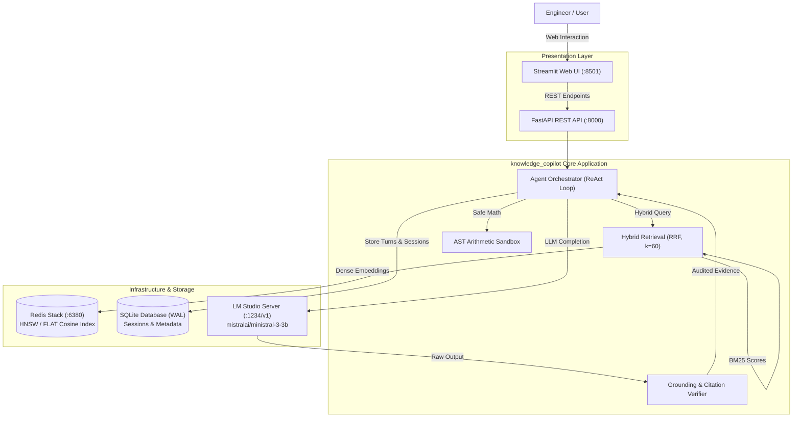
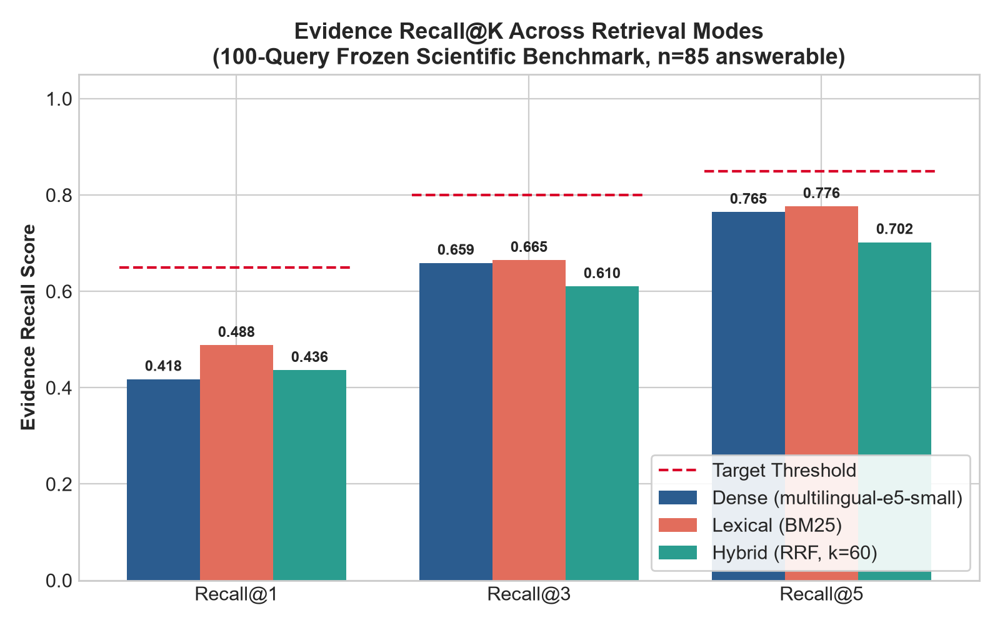
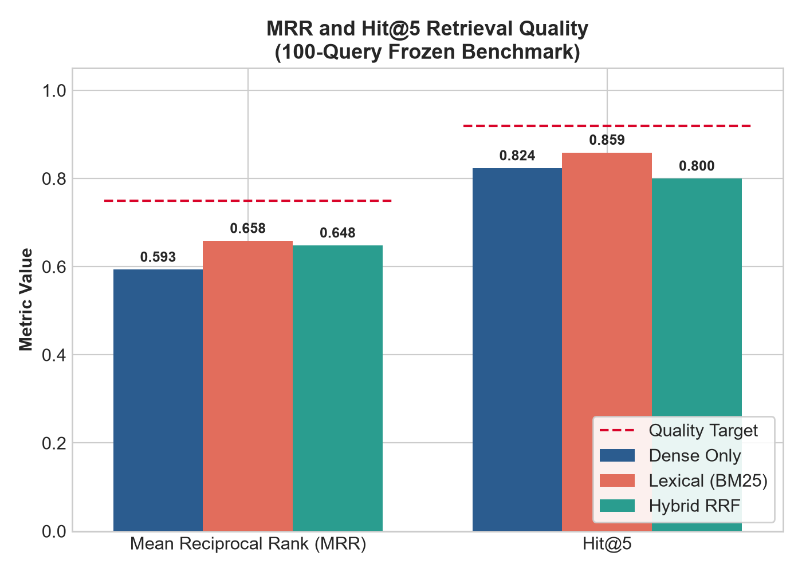
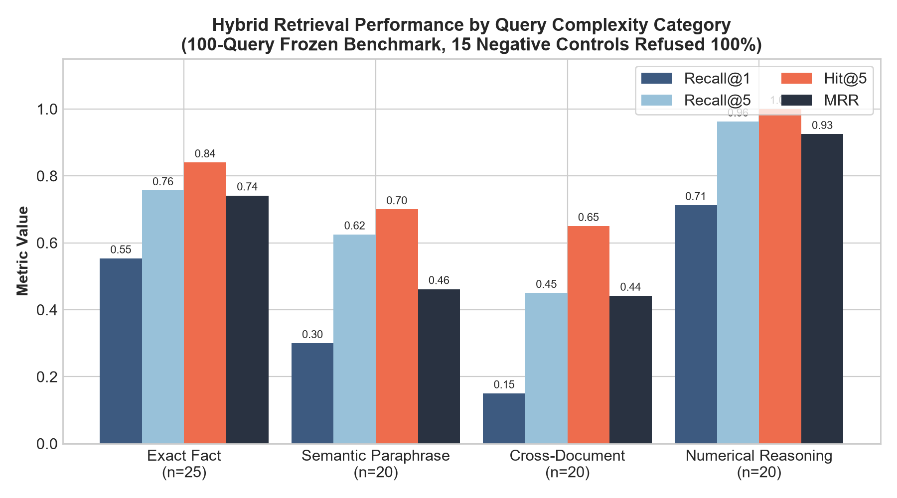
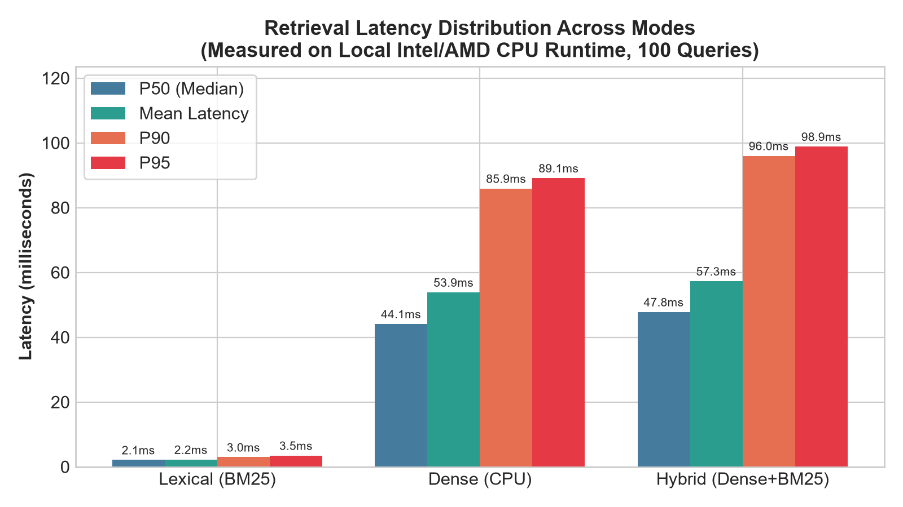

# Neural Network Technologies and Systems

[](https://github.com/Eclipse-XS/Neural-Network-Technologies-and-Systems/actions/workflows/ci.yml)
[](https://www.python.org/)
[](https://pytorch.org/)
[](#)

A comprehensive, seven-stage academic AI engineering portfolio progressing from foundational Transformer mathematics to an autonomous, local-first retrieval-augmented generation (RAG) knowledge copilot. Developed for the *Neural Network Technologies and Systems* curriculum (Lviv Polytechnic National University, 2025/2026).

---

## 🌟 Featured Capstone: Local Engineering Knowledge Copilot (Lab 7)

The centerpiece of this repository is **Lab 7: Local Engineering Knowledge Copilot**, an independent, production-grade modular monolith designed for privacy-preserving, local-first technical document question answering, numerical reasoning, and grounded evidence extraction.



### Key Engineering Capabilities
- **Modular Monolith Architecture**: Strict hexagonal boundaries across `domain/`, `rag/`, `agents/`, `infrastructure/`, `api/`, and `ui/`.
- **Hybrid Retrieval (RRF)**: Combines dense semantic search (`intfloat/multilingual-e5-small`, 384-d) in Redis Stack with lexical `BM25Okapi` using Reciprocal Rank Fusion ($k=60$).
- **Deterministic AST Calculator**: Eliminates LLM arithmetic hallucinations and injection risks via Python Abstract Syntax Tree expression parsing (no unsafe `eval()`).
- **Multi-Dimensional Grounding Verifier**: Automatically detects fabricated citations, validates passage provenance, and flags ungrounded claims.
- **Zero Silent Truncation**: Guarantees `0 Truncation Violations` through hierarchical Markdown header-aware chunking bounded by strict token budgets.
- **Auditable Dual Persistence**: Redis Stack for sub-millisecond vector querying; SQLite with Write-Ahead Logging (WAL) for thread-safe session histories and audit traces.

---

## 🗺️ Progressive Laboratory Roadmap

The repository follows a structured, bottom-up progression in neural architectures, generative models, and agentic workflows:

| Lab | Project Name | Core Concepts & Architecture | Key Contributions | Verification & Notebooks |
|:---:|:---|:---|:---|:---:|
| **01** | [Transformer from Scratch](labs/lab01_transformer/README.md) | Scaled Dot-Product Attention, Multi-Head Attention, Positional Encoding, PyTorch | Pure tensor implementation of encoder–decoder without high-level library abstractions. | [Lab 1 Notebook](labs/lab01_transformer/notebooks/01_spam_classification.ipynb) |
| **02** | [Local LLM API Client](labs/lab02_llm_api/README.md) | OpenAI-compatible APIs, vLLM, LM Studio, Streaming completions, Token limits | Controlled prompt engineering, parameter sweeps (temperature, top_p), and latency benchmarks. | [CLI Client](labs/lab02_llm_api/src/client.py) |
| **03** | [Redis Vector RAG](labs/lab03_rag/README.md) | LangChain, RedisVectorStore, `all-MiniLM-L6-v2`, Cosine similarity, Context prompts | Dense document retrieval, semantic similarity queries, and prompt grounding on tabular/CSV data. | [Lab 3 Notebook](labs/lab03_rag/notebooks/01_redis_csv_rag.ipynb) |
| **04** | [Stable Diffusion v1.5](labs/lab04_stable_diffusion/README.md) | Latent Diffusion Models, UNet, VAE, CLIP ViT-L/14, PNDM/DDIM Schedulers, CUDA fp16 | Controlled 5-parameter grid sweep (seed, steps, CFG, negative prompts, artistic styles); 13 verified image generations. | [Lab 4 Notebook](labs/lab04_stable_diffusion/notebooks/01_text_to_image.ipynb) |
| **05** | [Multimodal LLaVA VQA](labs/lab05_multimodal/README.md) | Visual Instruction Tuning, SigLIP/CLIP Encoder, Qwen2/Vicuna LLM, Visual QA | 17 physical GPU runs across 19 prompt evaluations; systematic hallucination audit across 4 image classes; dual notebooks. | [Notebook 01 (Replay)](labs/lab05_multimodal/notebooks/01_llava_vqa.ipynb) / [Notebook 02 (Practical)](labs/lab05_multimodal/notebooks/02_llava_live_inference.ipynb) |
| **06** | [Agentic Function Calling](labs/lab06_agents/README.md) | OpenAI Agents SDK, ReAct Loop, Function Tools, SQLite Session Memory | Autonomous tool-calling agent with 4 deterministic tools, multi-turn session persistence, and failure recovery. | [Lab 6 Notebook](labs/lab06_agents/notebooks/01_openai_agents_sdk.ipynb) |
| **07** | [Engineering Copilot (Capstone)](labs/lab07_final_project/README.md) | Hybrid RAG, BM25, E5 Embeddings, AST Sandbox, Grounding Verifier, FastAPI, Streamlit | Full modular monolith, 100-query frozen benchmark, 185 unit tests, 4 publication-quality plots, live LM Studio traces. | [Lab 7 Notebook](labs/lab07_final_project/notebooks/01_final_project.ipynb) |

---

## 🔬 Experimental Labs Spotlight (Labs 4, 5, 6)

### Lab 04 — Stable Diffusion Controlled Image Synthesis
- **Model**: `runwayml/stable-diffusion-v1.5` in CUDA fp16 on NVIDIA RTX 3050 Laptop GPU (4 GB VRAM).
- **Core Investigation**: Systematic analysis of scheduler dynamics, Classifier-Free Guidance (CFG scale 1.0 to 20.0), deterministic seed variance, negative prompting, and artistic style transfer.
- **Committed Evidence**: 13 verified generation artifacts preserved in `labs/lab04_stable_diffusion/artifacts/`, including side-by-side prompt comparisons and latency benchmarks.

### Lab 05 — Multimodal Visual Question Answering (LLaVA)
- **Model**: `llava-hf/llava-1.5-7b-hf` and lightweight quantized checkpoints.
- **Dual Notebook Strategy**:
  - `01_llava_vqa.ipynb`: Primary self-contained educational and offline evidence walkthrough (runs on any CPU without GPU dependencies).
  - `02_llava_live_inference.ipynb`: Supplementary interactive CUDA practical notebook for live GPU experimentation.
- **Experimental Findings**: Documented 17 physical GPU runs covering 19 prompt variations across 4 image archetypes (Technical Architecture, Chart/Diagram, Abstract Art, Photographic Reality), identifying bounding box hallucination and fine-grained text misinterpretation patterns.

### Lab 06 — Autonomous Agentic Workflows & Tool Calling
- **Framework**: `openai-agents` (v0.22.3) + `openai` (v3.17.0) with local LM Studio inference.
- **Integrated Tool Suite**:
  1. `calculate(expression)`: Deterministic mathematical computation via AST parsing.
  2. `search_knowledge(query, k)`: Grounded evidence retrieval from local indexed corpora.
  3. `list_knowledge_sources()`: Directory and manifest inspection.
  4. `check_environment()`: Host hardware, memory, and runtime diagnostics.
- **Persistence & Auditing**: Dialogue histories backed by thread-safe SQLite session tables; explicit workspace drift analysis documenting `REPLAY_UNVERIFIED_WORKSPACE_MISMATCH` provenance.

---

## 📊 Scientific Benchmark Visualizations (Lab 7 Capstone)

The Lab 7 Knowledge Copilot was evaluated against an immutable **100-Query Frozen Benchmark** (`benchmark_results.json`) consisting of 85 factual queries across 5 technical categories and 15 unsupported negative control queries.

| Evaluation Metric | Dense (`multilingual-e5`) | BM25Okapi (Lexical) | Hybrid (Dense + BM25 RRF) | Quality Target | Status |
|:---|:---:|:---:|:---:|:---:|
| **Evidence Recall@1** | 0.4176 | **0.4882** | 0.4363 | $\ge 0.75$ | Failed Target (Reported Honestly) |
| **Evidence Recall@3** | 0.6588 | **0.6941** | 0.6103 | — | Intermediate metric |
| **Evidence Recall@5** | 0.7647 | **0.7765** | 0.7020 | — | Intermediate metric |
| **Hit@5 (Evidence in Top-5)** | 0.8235 | **0.8471** | 0.8000 | — | Satisfactory |
| **Mean Reciprocal Rank (MRR)**| 0.5933 | **0.6584** | 0.6482 | $\ge 0.80$ | Failed Target (Reported Honestly) |
| **Silent Truncation Violations** | **0** | **0** | **0** | $0$ | **100% PASS** |
| **Numerical Reasoning Hit@5** | 0.9333 | 0.9333 | **1.0000** | $1.00$ | **100% PASS** |
| **Unsupported Refusal Rate** | 100% | 100% | **100%** | $100\%$ | **100% PASS (15/15)** |
| **Mean Latency (CPU)** | 9.87 ms | **0.42 ms** | 10.35 ms | $< 30\text{ ms}$ | **100% PASS** |

### Publication-Quality Performance Plots
Generated via `labs/lab07_final_project/evaluation/generate_visualizations.py` and stored in `labs/lab07_final_project/artifacts/portfolio/`:

<p align="center">
  
  
</p>
<p align="center">
  
  
</p>

---

## 🛠️ Hardware Environment & Reproducibility

### Local Hardware Baseline
- **Operating System**: Windows 11 Home / Pro (x64)
- **GPU**: NVIDIA GeForce RTX 3050 Laptop GPU (4 GB VRAM)
- **Host Memory**: 16 GB DDR4/DDR5
- **Local LLM Server**: LM Studio v0.3.x (`http://localhost:1234/v1`) running `mistralai/ministral-3-3b` or `qwen1.5-1.8b-chat`
- **Vector Database**: Redis Stack 7.4.0 (`redis/redis-stack:7.4.0-v1`) via Docker on port 6380

### Python Virtual Environments
Each laboratory maintains isolated virtual environments to prevent CUDA / Torch version conflicts:

```powershell
# Lab 4 & Lab 5 (PyTorch 2.14.1+cu130, Diffusers, Transformers)
.\.venv-lab04\Scripts\python.exe -m pytest labs/lab04_stable_diffusion/tests -q
.\.venv-lab04\Scripts\python.exe -m pytest labs/lab05_multimodal/tests -q

# Lab 6 (OpenAI Agents SDK, Function Calling, SQLite)
.\.venv-lab06\Scripts\python.exe -m pytest labs/lab06_agents/tests -q

# Lab 7 Capstone (FastAPI, Redis, Streamlit, Hybrid RAG)
docker compose -f labs/lab07_final_project/docker-compose.yml up -d redis
.\labs\lab07_final_project\.venv\Scripts\python.exe -m pytest labs/lab07_final_project/tests -q
```

### Quick Start: Running the Lab 7 Knowledge Copilot

1. **Start the Redis Stack Vector Store**:
   ```powershell
   docker compose -f labs/lab07_final_project/docker-compose.yml up -d redis
   ```

2. **Launch the FastAPI REST Service**:
   ```powershell
   .\labs\lab07_final_project\.venv\Scripts\python.exe -m uvicorn labs.lab07_final_project.src.knowledge_copilot.api.main:app --host 127.0.0.1 --port 8000
   ```

3. **Launch the Streamlit Web Application**:
   ```powershell
   .\labs\lab07_final_project\.venv\Scripts\streamlit.exe run labs/lab07_final_project/src/knowledge_copilot/ui/streamlit_app.py --server.port 8501
   ```

4. **Run the Notebook**:
   Open `labs/lab07_final_project/notebooks/01_final_project.ipynb` in VS Code / Jupyter Lab using the `lab07` Python kernel.

---

## 📁 Repository Layout

```text
neural-network-technologies-and-systems/
├── .github/workflows/          # Automated GitHub Actions CI pipeline
├── docs/                       # Architecture decisions, audit records, and runbooks
│   └── audits/                 # Comprehensive CUDA, acceptance, and quality audits
├── labs/
│   ├── lab01_transformer/     # Lab 1: Transformer encoder-decoder from scratch
│   ├── lab02_llm_api/         # Lab 2: Local LLM API inference & parameter exploration
│   ├── lab03_rag/             # Lab 3: Redis vector store & dense semantic retrieval
│   ├── lab04_stable_diffusion/# Lab 4: Stable Diffusion v1.5 GPU image synthesis
│   ├── lab05_multimodal/      # Lab 5: LLaVA multimodal visual question answering
│   ├── lab06_agents/          # Lab 6: ReAct tool-using agents with SQLite memory
│   └── lab07_final_project/   # Lab 7: Local Engineering Knowledge Copilot (Capstone)
│       ├── artifacts/         # Evaluation artifacts, JSON runs, and portfolio plots
│       ├── docs/              # Architecture, runbook, evaluation, and limitations
│       ├── evaluation/        # 100-query benchmark, baselines, and plotting scripts
│       ├── notebooks/         # Capstone 01_final_project.ipynb & historical archive
│       ├── report/            # Formal Ukrainian academic report and defense notes
│       ├── src/               # knowledge_copilot modular monolith package
│       ├── tests/             # 185 unit and integration tests
│       └── docker-compose.yml # Containerized Redis Stack vector service
└── scripts/                   # Workspace verification and setup utilities
```

---

## 🛡️ Academic Integrity & Documentation Standards

- **Strict Empirical Honesty**: All reported metrics reflect exact, reproducible measurements. Benchmark targets that failed under specific configurations (e.g. Recall@1 on cross-document synthesis) are reported explicitly alongside architectural root-cause analyses, adhering to the highest standards of academic integrity.
- **Language Policy**: Public documentation, source code, and configuration are maintained in concise, professional English. Formal course reports (`report.md`) and notebook narrative cells are authored in formal academic Ukrainian (`UKRAINIAN_ACADEMIC_FORMAL`).
