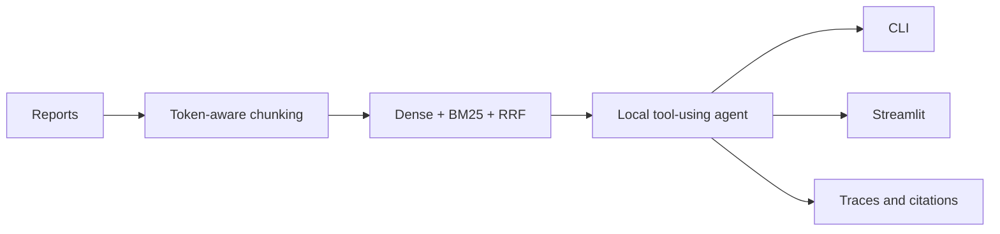

# Neural Network Technologies and Systems

Seven engineering-focused laboratory projects progressing from transformer fundamentals to a local tool-using RAG application. The repository emphasizes reproducible experiments, explicit failure analysis, offline tests, and inspectable evidence without presenting mocks as live inference.

## Engineering progression

| Stage | Project | Capability |
|---|---|---|
| 1 | [Transformer from scratch](labs/lab01_transformer/README.md) | Attention, encoder–decoder internals, training loops |
| 2 | [Local LLM API](labs/lab02_llm_api/README.md) | OpenAI-compatible inference and controlled generation |
| 3 | [Redis RAG](labs/lab03_rag/README.md) | Loading, embeddings, vector search, grounded prompts |
| 4 | [Stable Diffusion](labs/lab04_stable_diffusion/README.md) | GPU inference, controlled experiments, provenance |
| 5 | [LLaVA VQA](labs/lab05_multimodal/README.md) | Vision-language inference, hallucination analysis |
| 6 | [Tool-using agent](labs/lab06_agents/README.md) | Agents SDK, local tools, SQLite memory, traces |
| 7 | [Knowledge assistant](labs/lab07_final_project/README.md) | Token-safe hybrid RAG, citations, CLI and web UI |

## Featured final project

Lab 7 combines Redis dense retrieval, BM25, reciprocal-rank fusion, a bounded calculator, OpenAI Agents SDK, SQLite sessions, LM Studio, CLI, and Streamlit. Deterministic IDs, source hashes, namespace isolation, tool traces, and citation checks make failures auditable.



The historical experiment exposed serious retrieval and orchestration failures; they are documented rather than erased. Current code removes uncontrolled embedding truncation and adds evidence-level evaluation, but new live quality targets are not claimed before rerunning the full stack.

## GPU Environment Setup

GPU workloads in this repository run on Windows 11 with the **NVIDIA GeForce RTX 3050 Laptop GPU (4 GB VRAM)**. Dedicated Jupyter kernels and Python environments are mapped to each lab to avoid cross-environment conflicts and ensure reproducible CUDA execution.

| Lab | Purpose | Environment | Jupyter Kernel | Backend |
|---|---|---|---|---|
| **Lab 01** | Transformer Encoder / Decoder | `.venv-lab04` | `lab01-transformer` | CUDA (RTX 3050) |
| **Lab 02** | LLM API Client | `.venv-lab06` | `lab06-agents` | CPU / WSL2 vLLM |
| **Lab 03** | Redis CSV RAG | `labs/lab03_rag/.venv` | `lab03-rag` | CPU (Embeddings) |
| **Lab 04** | Stable Diffusion 1.5 | `.venv-lab04` | `lab04-cuda` | CUDA (RTX 3050) |
| **Lab 05** | LLaVA Multimodal VQA | `labs/lab05_multimodal/.venv` | `lab05-cuda` | CUDA (RTX 3050) |
| **Lab 06** | OpenAI Agents SDK | `.venv-lab06` | `lab06-agents` | CPU / LM Studio |
| **Lab 07** | Agentic RAG Final Project | `labs/lab07_final_project/.venv` | `lab07` | CUDA (RTX 3050) |

To verify and maintain your environment:

```powershell
# Verify real CUDA GPU tensor compute across all environments
powershell -ExecutionPolicy Bypass -File scripts/verify_cuda.ps1

# Run full project-wide environment and Jupyter kernel audit
& ".venv-lab04\Scripts\python.exe" scripts/check_ml_environments.py

# Re-register Jupyter kernels and normalize notebook metadata
powershell -ExecutionPolicy Bypass -File scripts/setup_jupyter_kernels.ps1
```

> [!NOTE]
> Detailed forensic findings and verified benchmarks are documented in [CUDA Baseline Audit](docs/audits/PROJECT_WIDE_CUDA_BASELINE.md) and [CUDA Final Report](docs/audits/PROJECT_WIDE_CUDA_FINAL.md).

## Stack, testing, and reproducibility

Python, PyTorch, Transformers, Diffusers, LangChain, Redis Stack, sentence-transformers, OpenAI Agents SDK, LM Studio, SQLite, Streamlit, pytest, nbclient, Docker Compose, and GitHub Actions.

Each lab has isolated dependencies. Offline repository checks use import-isolated discovery:

```powershell
py -3.13 -m pytest
```

Large models, caches, vector databases, private sessions, and generated outputs are not committed. CPU CI validates code and offline behavior; it does not claim live LLM/CUDA E2E. Hardware timings are observations, not general benchmarks. No license was added because licensing is an owner decision.

```text
labs/                 isolated laboratory projects
docs/audits/          cross-project QA and acceptance records
.github/workflows/    offline CI; live tests are separately gated
scripts/              reproducibility helpers
tests/                repository-level structural checks
```

Use the [Lab 7 README](labs/lab07_final_project/README.md) and [acceptance audit](docs/audits/FINAL_PORTFOLIO_ACCEPTANCE.md) for exact Windows commands and current limitations.
