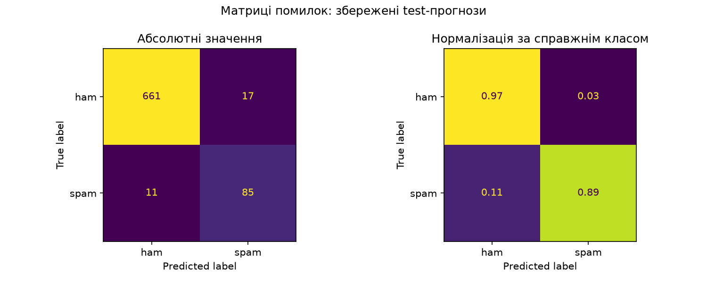

# Lab 01 — Transformer Models from Scratch (PyTorch)

## Overview

From-scratch PyTorch implementations of Transformer architectures trained without pretrained backbones:
- **Encoder Classifier**: ham/spam SMS classification on `spam.csv` using sinusoidal positional encoding, multi-head self-attention layers, mean pooling, and class-weighted cross-entropy with validation-based early stopping.
- **Autoregressive Decoder Language Model**: causal next-token language modeling on BBC News articles (`bbc-text.csv`) using masked self-attention and multiple decoding strategies (greedy, temperature, top-k, top-p, repetition penalty, no-repeat n-gram).

## Main Implementation Files

- Notebooks:
  - [`notebooks/01_spam_classification.ipynb`](notebooks/01_spam_classification.ipynb) — data preparation, encoder training, hyperparameter grid (`d_model` × `nhead`), test evaluation
  - [`notebooks/02_text_generation.ipynb`](notebooks/02_text_generation.ipynb) — causal decoder training, validation perplexity selection, text continuation
- Source modules (`src/`):
  - [`src/common/`](src/common/) — lowercase regex tokenizer (`text.py`), `positional_encoding.py`, training loop (`training.py`), checkpoints (`checkpoint.py`), seeding (`reproducibility.py`), and plotting (`visualization.py`)
  - [`src/classification/`](src/classification/) — dataset splitting (`data.py`), `SpamClassifier` (`model.py`), `train.py`, `evaluate.py`
  - [`src/generation/`](src/generation/) — document-level split & sliding windows (`data.py`), `CausalLanguageModel` (`model.py`), `train.py`, `evaluate.py`, decoding strategies (`generate.py`), `diagnostics.py`
- Diagnostic scripts (`scripts/`):
  - [`scripts/run_classification_diagnostics.py`](scripts/run_classification_diagnostics.py)
  - [`scripts/run_generation_diagnostics.py`](scripts/run_generation_diagnostics.py)
- Local datasets (`data/raw/`): gitignored local CSVs (`spam.csv`, `bbc-text.csv`); schemas: `Category,Message` and `category,text`.

## How to Run

Install dependencies and execute either notebook in Jupyter or via Python:

```powershell
python -m venv labs/lab01_transformer/.venv
.\labs\lab01_transformer\.venv\Scripts\python.exe -m pip install -r labs/lab01_transformer/requirements.txt
.\labs\lab01_transformer\.venv\Scripts\python.exe -m jupyter notebook labs/lab01_transformer/notebooks/01_spam_classification.ipynb
```

Post-hoc diagnostic plots (after notebook outputs are generated):

```powershell
.\labs\lab01_transformer\.venv\Scripts\python.exe labs/lab01_transformer/scripts/run_classification_diagnostics.py
.\labs\lab01_transformer\.venv\Scripts\python.exe labs/lab01_transformer/scripts/run_generation_diagnostics.py
```

## Representative Example

- **Spam Classification (`01_spam_classification.ipynb`)**: best configuration selected by validation F1 (`d_model=128`, `nhead=4`, `num_layers=1`, `vocab_size=3202`, `max_len=42`) achieved test **accuracy = 0.9638**, **precision = 0.8333**, **recall = 0.8854**, **F1 = 0.8586** on `774` held-out messages.
- **BBC Text Generation (`02_text_generation.ipynb`)**: selected causal decoder (`d_model=128`, `nhead=2`, `vocab_size=12000`, `window=64`) achieved test **perplexity = 276.82** (`rouge_l = 0.1064`).


