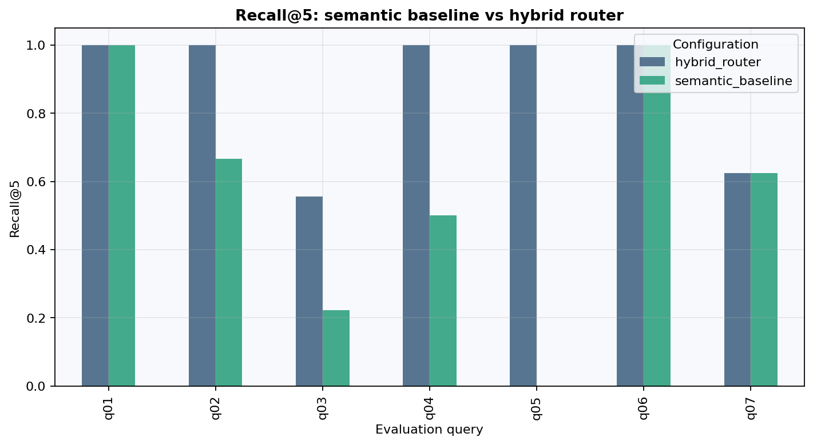

# Lab 03 — CSV Retrieval-Augmented Generation with Redis Stack

## Reproducible execution (Windows 11 / Python 3.13)

Run from the repository root in PowerShell. Each lab has an isolated `.venv` and a complete `requirements.lock.txt`.

```powershell
.\setup.ps1 -Lab 3
.\run.ps1 -Lab 3 -Smoke
.\run.ps1 -Lab 3
```

LM Studio: http://localhost:1234/v1, Ministral 3 3B, context 16384, GPU offload disabled.

`-Cuda` selects PyTorch 2.14.1+cu130 from the official CUDA 13.0 wheel index. The NVIDIA driver is required; these wheels do not require a separate CUDA toolkit. Omit this switch for CPU PyTorch. Vision smoke tests use the original model weights, batch size 1, 512x512 images and short real inference. They do not establish image quality or repeat the full experimental matrix.

Model revision SHAs and weight checksums are in the root `models.lock.json`. Distributed input checksums are in `inputs.sha256.json` (text is normalized to LF). Setup downloads required models and NNTS datasets. Smoke tests use real services; unavailable services cause a failure. See the root `REPRODUCIBILITY.md` for sources, service preparation and verification limits.

## Overview

Local RAG pipeline over a 185-product catalog spanning three CSV datasets (`dresses.csv`, `earrings.csv`, `sports-shoes.csv`). Compares a dense semantic Redis Stack baseline (`all-MiniLM-L6-v2`, 384-d cosine similarity) against an intent-aware `hybrid` router combining Redis semantic lookup with exact product ID, attribute filter, and numeric catalog aggregation.

## Main Implementation Files

- [`notebooks/01_redis_csv_rag.ipynb`](notebooks/01_redis_csv_rag.ipynb) — 16-step walkthrough covering CSV ingestion, embedding inspection, Redis Stack indexing, retrieval metrics, and semantic vs. hybrid comparison
- [`src/rag.py`](src/rag.py) — primary `answer_query(store, llm, question, ..., mode="hybrid" | "semantic_baseline")` entrypoint, prompt construction, and `[source_file:row_id]` citation validator
- [`src/hybrid.py`](src/hybrid.py), [`src/retrieval.py`](src/retrieval.py) — intent parsing, structured catalog filtering, numeric reasoning, and Redis vector retrieval
- [`src/data.py`](src/data.py), [`src/documents.py`](src/documents.py), [`src/embeddings.py`](src/embeddings.py), [`src/llm.py`](src/llm.py), [`src/evaluation.py`](src/evaluation.py) — strict row-per-document CSV loader, Hugging Face embeddings, LM Studio chat client, and Hit@K / MRR / Recall@K evaluators
- [`data/raw/csv/`](data/raw/csv/) — curated CSV subset (`dresses.csv`, `earrings.csv`, `sports-shoes.csv`)
- [`queries.json`](queries.json) — 8 curated evaluation queries (`q01`–`q08`)
- [`docker-compose.yml`](docker-compose.yml) — Redis Stack `7.4.0-v8` (`127.0.0.1:6379`)
- [`outputs/examples/`](outputs/examples/) — [`baseline_vs_hybrid.csv`](outputs/examples/baseline_vs_hybrid.csv) and [`baseline_vs_hybrid.png`](outputs/examples/baseline_vs_hybrid.png)

## How to Run

1. Start Redis Stack and LM Studio (`http://localhost:1234/v1`):

   ```powershell
   docker compose -f labs/lab03_rag/docker-compose.yml up -d
   ```

2. Create/install environment (`setup.ps1`) and run the notebook:

   ```powershell
   .\labs\lab03_rag\setup.ps1
   $env:LM_STUDIO_MODEL = "mistralai/ministral-3-3b"
   .\labs\lab03_rag\.venv\Scripts\python.exe -m jupyter notebook labs/lab03_rag/notebooks/01_redis_csv_rag.ipynb
   ```

## Representative Example

From [`outputs/examples/baseline_vs_hybrid.csv`](outputs/examples/baseline_vs_hybrid.csv):

| Query | Kind | Mode | Hit@5 | MRR | Recall@5 | Returned |
|---|---|---|---:|---:|---:|---:|
| `q05` | `multi_condition` | `semantic_baseline` | 0.00 | 0.00 | 0.00 | 5 |
| `q05` | `multi_condition` | `hybrid_router` | 1.00 | 1.00 | 1.00 | 5 |
| `q08` | `unsupported` | `semantic_baseline` | — | — | — | 5 |
| `q08` | `unsupported` | `hybrid_router` | — | — | — | 0 |


