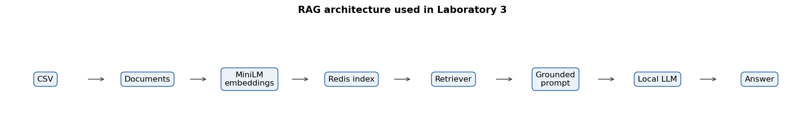
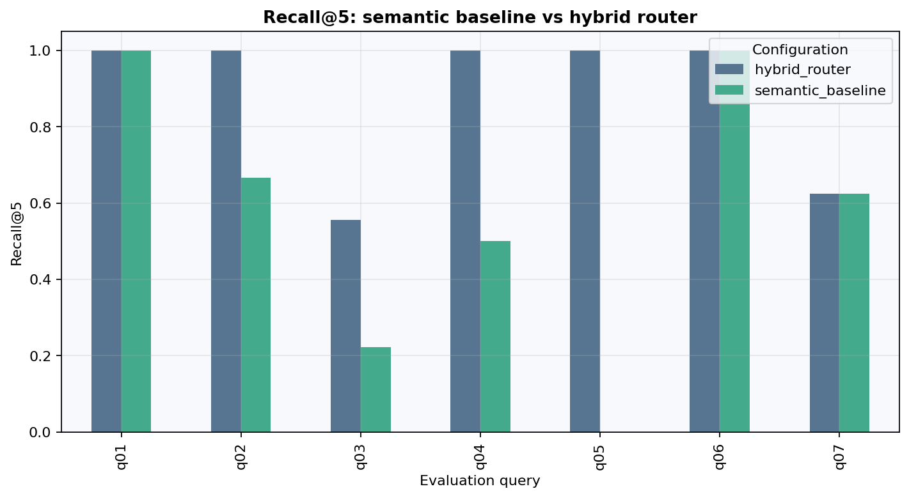

# Лабораторна робота №3. RAG із Redis і CSV

**Варіант 3.** Локальна RAG-система над каталогом із 185 товарів. Semantic baseline використовує MiniLM і Redis; hybrid router окремо обробляє точні ID, атрибути та числові умови. Ground-truth labels застосовуються лише під час evaluation.

## Архітектура

`CSV → CSVLoader → Document → MiniLM embedding → Redis FLAT/COSINE → retrieval → grounded prompt → LM Studio → evaluation`

Основний API — `src.rag.answer_query()`. Режим `semantic_baseline` виконує Redis retrieval і LLM generation. Режим `hybrid` спочатку визначає intent: semantic запити передає Redis, а exact/structured запити обробляє за каталогом. Усі результати зберігають `source_file`, `row_id` і `product_id`.



## Дані

Корпус містить 100 суконь, 51 пару спортивного взуття та 34 пари сережок. Зафіксовано 32 пропущені знижки, 22 товари без спостережуваного рейтингу та 29 конфліктів між listed price і формулою знижки. Raw values не виправляються; числові похідні мають окремі поля. Отримання CSV і SHA-256 описано в [data/README.md](data/README.md), структура — у [dataset_audit.md](dataset_audit.md).

Один рядок відповідає одному `Document`. Це не дає character chunking розділити ціну, опис і provenance одного товару. `all-MiniLM-L6-v2` повертає нормалізовані вектори розмірності 384; 17 довгих записів обрізаються tokenizer до 256 word pieces.

## Експеримент

[Notebook](notebooks/01_redis_csv_rag.ipynb) має 16 кроків: завантаження й EDA, `CSVLoader`, embeddings, PCA, Redis index, retrieval, Hit@5/MRR/Recall@5, grounded prompt, citation audit, failure analysis, semantic-vs-hybrid comparison і dashboard.

Вісім зафіксованих запитів охоплюють exact lookup, semantic search, filter, comparison, global numeric condition, cross-category retrieval та unsupported delivery request. Semantic baseline отримав Hit@5 = 0,8571, MRR = 0,6905 і mean Recall@5 = 0,5734 на семи запитах із relevance labels. Hybrid router — 1,0000, 1,0000 і 0,8829 відповідно. Це retrieval-метрики малого curated set, а не accuracy відповідей LLM.

Для post-rule wording set із п’яти labeled запитів отримано Hit@5 = 1,0000, MRR = 1,0000 і Recall@5 = 0,9111. Формулювання створено після фіксації правил router, але це не зовнішній незалежний benchmark; обсяг вибірки недостатній для статистичних узагальнень.



Відомі помилки не приховано: q01 — суперечливі price fields, q03 — помилка одиниць і citation format, q04 — неповне multi-record retrieval. Повна taxonomy міститься в [error_taxonomy.csv](artifacts/portfolio/error_taxonomy.csv).

## Запуск

```powershell
python -m venv labs/lab03_rag/.venv
labs/lab03_rag/.venv/Scripts/pip install -r labs/lab03_rag/requirements.txt
labs/lab03_rag/.venv/Scripts/python -m jupyter notebook labs/lab03_rag/notebooks/01_redis_csv_rag.ipynb
```

Для повного експерименту потрібні перевірені CSV, Redis Stack і локальна chat-модель у LM Studio:

```powershell
docker compose -f labs/lab03_rag/docker-compose.yml up -d
$env:LM_STUDIO_MODEL='mistralai/ministral-3-3b'
labs/lab03_rag/.venv/Scripts/python -m jupyter nbconvert --to notebook --execute --inplace `
  labs/lab03_rag/notebooks/01_redis_csv_rag.ipynb
```

Notebook має один режим: реальне виконання. Якщо Redis, MiniLM або LM Studio недоступні,
відповідний STEP завершується діагностичною помилкою; історичні результати не підставляються.

## Перевірки й обмеження

```powershell
python -m pytest labs/lab03_rag/tests -q
```

Тести перевіряють data contracts, routing, anti-leakage, metrics, citations, notebook execution і відсутність viewer-only experiment steps. Live integration потребує Redis та LM Studio.

Корпус і query set малі; labels не є повною human relevance розміткою. Latency містить embedding, network і parsing та має по одному спостереженню. Покращення retrieval не доводить покращення answer correctness; semantic completeness потребує ручного entailment-аудиту.
