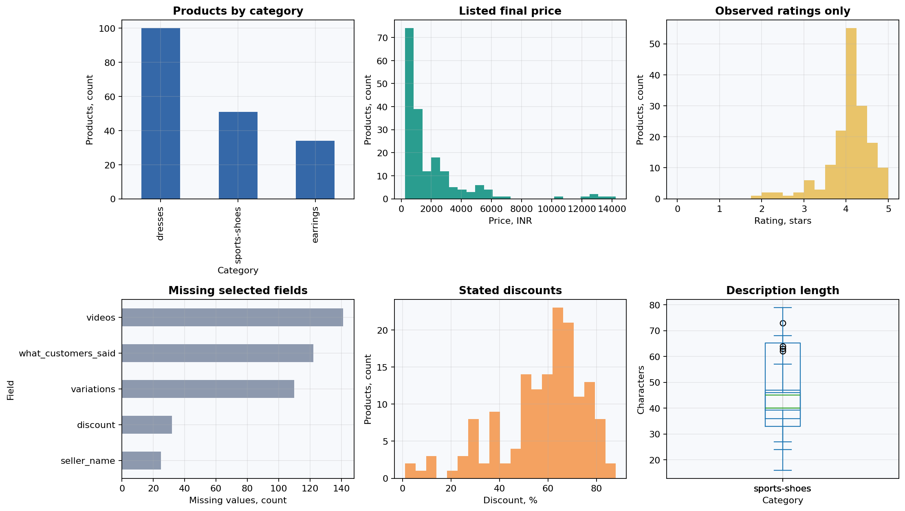

# Laboratory 3: Retrieval-Augmented Generation with Redis and CSV

## Project Overview

This project builds and audits a local RAG pipeline over a 185-product catalog. It preserves an honest semantic-search baseline, demonstrates why vector similarity fails on exact and aggregate questions, and compares it with a deterministic hybrid router.


## Educational Objectives

The notebook explains document construction, MiniLM embeddings, token truncation, cosine distance, Redis indexing, retrieval metrics, grounded prompting, citation checks, numeric verification, failure analysis, and query routing.

## Official Variant and Requirements

Variant 3 requires 2–3 CSV files loaded through `CSVLoader`, `all-MiniLM-L6-v2`, Redis Vector Similarity with cosine distance, and a local OpenAI-compatible LLM. This implementation uses three source CSV files, one product row per document, Redis Stack, and LM Studio.

## Architecture

`CSV → CSVLoader → row Document → normalized MiniLM embedding → Redis FLAT/COSINE index → semantic or structured retrieval → grounded prompt → local LLM → evaluated answer`

## Technology Stack

- Python 3.13, pandas, NumPy, matplotlib
- LangChain Core, Community, Redis, Hugging Face and OpenAI integrations
- `sentence-transformers/all-MiniLM-L6-v2`, 384 dimensions
- Redis Stack with `FLOAT32`, `FLAT`, `COSINE`
- LM Studio local OpenAI-compatible endpoint
- pytest and notebook schema/syntax checks

## Dataset

The frozen corpus contains 100 dresses, 51 sports shoes and 34 earrings. It has 24 source columns, 32 missing discount values, 22 unrated records represented as rating 0 with zero ratings, and 29 price/discount formula conflicts. Acquisition and SHA-256 verification are documented in [data/README.md](data/README.md).



## Step-by-Step Workflow

The [notebook](notebooks/01_redis_csv_rag.ipynb) has 16 stages: RAG concepts, environment, dataset, EDA, loader, embeddings, PCA, Redis, retrieval, metrics, prompt, answer evaluation, error analysis, improvement experiments, dashboard, and limitations.

## Experimental Design

Eight frozen queries cover direct lookup, semantic search, metadata filtering, two-record comparison, a global numeric condition, cross-category comparison, a broad semantic request and an unsupported delivery question. Ground truth and corpus hashes are fixed in `queries.json`.

## Results and Visualizations

The semantic baseline achieved Hit@5 = 0.8571, MRR = 0.6905 and mean Recall@5 = 0.5734 over seven labeled queries. The leakage-free hybrid router achieved Hit@5 = 1.0000, MRR = 1.0000 and mean Recall@5 = 0.8829 on the same labels. It extracts exact IDs from user text and applies documented attribute/numeric rules; it never receives relevance labels.


## Quantitative Evaluation

Detailed per-query values are in [baseline_vs_hybrid.csv](artifacts/portfolio/baseline_vs_hybrid.csv). Recall@5 is separate from Hit@5; q03 has nine relevant products, so Recall@5 cannot exceed 5/9.

The independent wording holdout has five labeled retrieval questions plus one unsupported request. Its labeled means are Hit@5 = 1.0000, MRR = 1.0000 and Recall@5 = 0.9111. This set is too small for statistical claims; it checks that rules generalize beyond the original eight strings. See [holdout_evaluation.csv](artifacts/portfolio/holdout_evaluation.csv).

## Evaluation Integrity

Inference and evaluation are separated. `src/hybrid.py` accepts only the user question, catalog and optional semantic candidates. Ground-truth IDs and expected fields are consumed only by `evaluate_id_lists()` after retrieval. Anti-leakage tests mutate labels, expected fields and query IDs; retrieval must remain unchanged.

## Error Analysis

The machine-readable taxonomy covers inconsistent source fields, missing-value semantics, unit errors, incomplete multi-row retrieval, incorrect global aggregation, arithmetic errors, unsupported claims, and correct abstention. See [error_taxonomy.csv](artifacts/portfolio/error_taxonomy.csv).

## Engineering Decisions

- One row is one document to preserve product-level provenance.
- Raw values remain intact; numeric values are derived and explicitly named.
- Redis indexing is corpus-fingerprinted and idempotent.
- Structured retrieval is used only for explicit exact/numeric intent.
- LLM lexical field checks are not presented as semantic correctness.

## Reproducibility

1. Download and verify the dataset as documented under `data/`.
2. Install `requirements.txt` without replacing an existing CUDA build.
3. Start Redis: `docker compose -f labs/lab03_rag/docker-compose.yml up -d`.
4. Load a local chat model in LM Studio and set `LM_STUDIO_MODEL`.
5. Run the notebook from top to bottom.

## Installation and Execution

```powershell
python -m venv labs/lab03_rag/.venv
labs/lab03_rag/.venv/Scripts/pip install -r labs/lab03_rag/requirements.txt
labs/lab03_rag/.venv/Scripts/python -m jupyter notebook labs/lab03_rag/notebooks/01_redis_csv_rag.ipynb
```

## Testing

```powershell
labs/lab03_rag/.venv/Scripts/python -m pytest labs/lab03_rag/tests -q
```

Unit tests do not require Redis or LM Studio. Integration checks require their services and are reported separately.

## Limitations

The corpus is small and domain-specific. Relevance labels are not a complete human benchmark. Stored latency is a single observation per query and includes embedding, networking and parsing. The tokenizer audit, not the prompt, is the authority for the actual truncation count.

## Portfolio Highlights

The project demonstrates data contracts, provenance, vector database validation, machine-readable evaluation, honest failure analysis, deterministic numeric tools and a public curated artifact layer without publishing caches or model weights.
