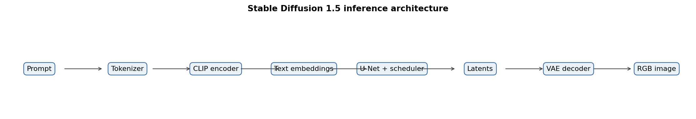
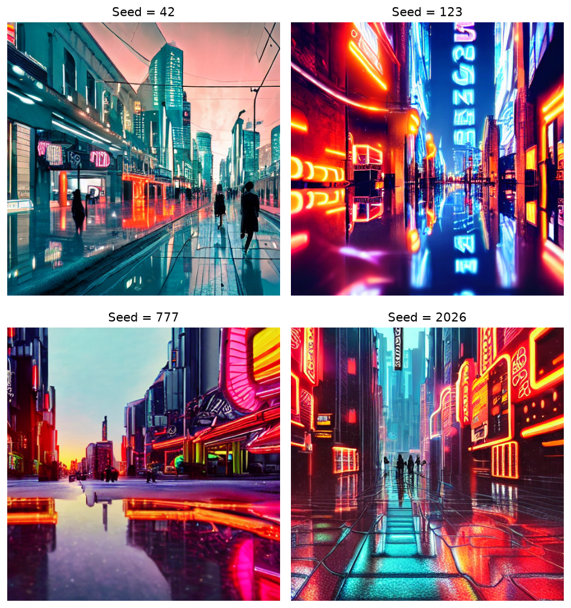
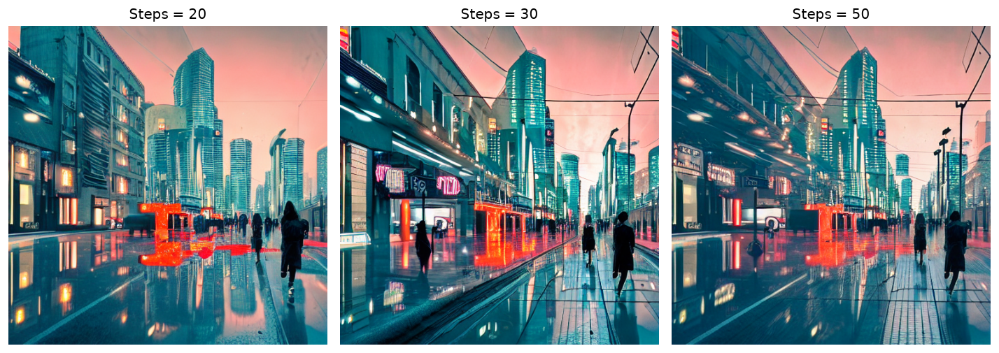
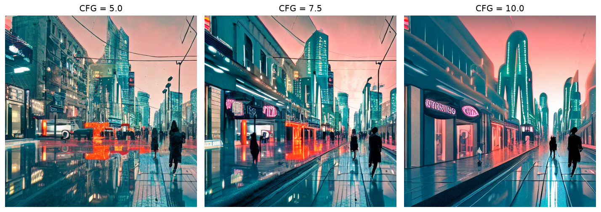

# Laboratory 4: Stable Diffusion Text-to-Image

## Project Overview

This project is a controlled local Stable Diffusion 1.5 study on an NVIDIA RTX 3050 Laptop GPU with 4 GB VRAM. It preserves 13 verified generations, their complete controls, SHA-256 hashes, runtime observations and visual analysis.



## Educational Objectives

The notebook explains diffusion training and sampling, latent space, CLIP conditioning, U-Net denoising, schedulers, VAE decoding, classifier-free guidance, reproducible seeds, negative prompts, prompt-based styling, performance limits and LoRA.

## Official Variant and Requirements

Variant 1 requires Text-to-Image generation, parameter studies for seed, steps and CFG, negative-prompt comparisons, three styles, persisted parameters and an optional scheduler study. The implementation uses SD 1.5 at 512×512.

## Architecture

`Prompt → tokenizer → CLIP text encoder → text embeddings → U-Net + PNDM scheduler → latent → VAE decoder → RGB image`

## Technology Stack

Python, PyTorch, Diffusers, Transformers, Accelerate, safetensors, Pillow, pandas and matplotlib. The verified run used FP16, model CPU offload and PyTorch SDPA.

## Model

The exact model is `stable-diffusion-v1-5/stable-diffusion-v1-5` at revision `451f4fe16113bff5a5d2269ed5ad43b0592e9a14`. SD 1.5 is materially more realistic on 4 GB VRAM than SDXL.

## Step-by-Step Workflow

The [notebook](notebooks/01_text_to_image.ipynb) contains 17 stages from generative-model fundamentals through the experiment dashboard, LoRA and limitations.

## Experimental Design

- Seeds: 42, 123, 777, 2026
- Inference steps: 20, 30, 50
- CFG: 5, 7.5, 10
- Negative prompt: controlled pairs for seeds 42 and 123
- Styles: watercolor, isometric, photorealistic
- Scheduler: PNDM verified; Euler and DDIM explicitly not executed

The canonical baseline is reused across groups, producing 13 unique configurations rather than duplicated inference.

## Results and Visualizations







## Quantitative Evaluation

Runtime and peak-memory fields are recorded per generation. They are observations, not benchmarks: most configurations have one run, and the first baseline includes warm-up effects. See [performance_summary.csv](artifacts/portfolio/performance_summary.csv).

## Error Analysis

Manual visual review records prompt/style adherence, pseudo-text, malformed small objects, composition changes and the limits of negative prompts. No CLIPScore or FID is claimed because neither was validly computed for this experiment.

## Engineering Decisions

- Every artifact identity includes controls, model revision, scheduler config and runtime stack.
- Cache reuse requires identity match, file integrity, valid PNG decoding and expected dimensions.
- CPU generators improve reproducibility with model offload.
- Existing CUDA/PyTorch packages are never replaced automatically.

## Portfolio Replay

The versioned notebook executes on CPU without CUDA or a model download:

```powershell
$env:PORTFOLIO_MODE='replay'
python scripts/execute_portfolio_notebooks.py --mode replay
```

It reads the 13 curated PNGs, manifest, galleries and `historical_environment.json` from `artifacts/portfolio/`. Outputs are labeled `REPLAYED FROM VERIFIED EVIDENCE`; `generations.csv` is a manifest of historical inference, not a replacement for inference.

## Full Experimental Execution

Install the declared packages while preserving a working CUDA-enabled PyTorch build. Set `PORTFOLIO_MODE=full` and run the generation entrypoint before the notebook. A second run reuses an artifact only after full integrity validation. PNDM is the only executed scheduler; Euler, DDIM and LoRA remain `NOT_EXECUTED`.

## Installation and Execution

```powershell
python -m venv labs/lab04_stable_diffusion/.venv
labs/lab04_stable_diffusion/.venv/Scripts/pip install -r labs/lab04_stable_diffusion/requirements.txt
labs/lab04_stable_diffusion/.venv/Scripts/python -m jupyter notebook labs/lab04_stable_diffusion/notebooks/01_text_to_image.ipynb
```

Do not blindly reinstall PyTorch on the original machine.

## Testing

```powershell
python -m pytest labs/lab04_stable_diffusion/tests -q
```

Unit tests validate the experiment matrix, identities, cache integrity, notebook schema and evaluation contracts without downloading the model.

## Limitations

The study has one verified image per configuration, one verified scheduler, a single model and resolution, no repeated warmed runs, no CLIPScore, and no LoRA training. Visual judgments are qualitative and cannot establish general model quality.

## Portfolio Highlights

The project shows controlled one-factor experiments, resumable generation, provenance, content-addressed artifacts, explicit non-executed states, machine-readable manifests and GitHub-visible galleries.
