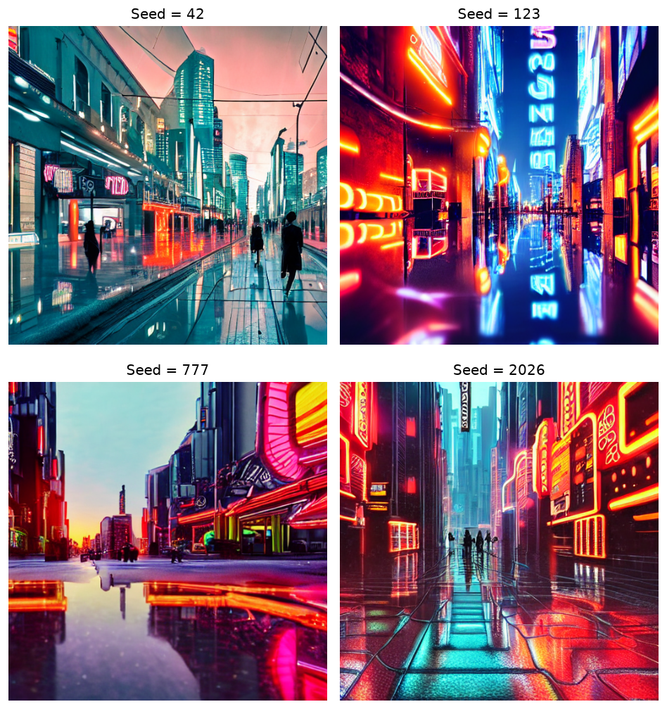

# Lab 04 — Stable Diffusion Text-to-Image Synthesis

A reproducible, controlled experimental study of latent text-to-image diffusion using **Stable Diffusion v1.5** under consumer GPU memory constraints (NVIDIA GeForce RTX 3050 Laptop GPU, 4 GB VRAM).


*Representative baseline generation: "A cinematic photo of an ancient stone library overgrown with ivy, dusty sunbeams streaming through stained glass windows, highly detailed, photorealistic, 8k resolution" (Seed: 42, Steps: 30, CFG: 7.5, PNDM Scheduler).*

---

## Overview

Latent Diffusion Models (LDMs) separate the high-dimensional perceptual compression stage (handled by an autoencoder) from the iterative generative modeling stage (handled by a conditional U-Net denoiser). This project investigates the mechanics of text-to-image generation through 13 uniquely parameterized, cryptographically tracked generation runs.

The study isolates five key generation variables—random seed, inference step budget, Classifier-Free Guidance (CFG) scale, negative prompt suppression, and stylistic prompt steering—while enforcing strict memory management to prevent out-of-memory (OOM) faults on a 4 GB VRAM GPU.

---

## Objectives

1. **Investigate Latent Diffusion Mechanics**: Map the end-to-end tensor pipeline from BPE prompt tokenization and CLIP text embeddings to U-Net noise prediction, PNDM iterative denoising, and VAE pixel decoding.
2. **Execute Controlled Variable Experiments**: Quantify the perceptual and computational impact of random seeds, denoising steps (20, 30, 50), CFG scales (5.0, 7.5, 10.0), negative prompt pairs, and stylistic suffixes.
3. **Ensure Reproducibility Under Hardware Constraints**: Implement FP16 precision, PyTorch SDPA (Scaled Dot-Product Attention), and sequential model CPU offloading to maintain stable execution under 4 GB VRAM.
4. **Enforce Cryptographic Provenance**: Record runtime duration, peak CUDA memory allocation, generation parameter vectors, and output image SHA-256 hashes in a versioned audit manifest.

---

## Technology Stack

| Layer | Component | Specification |
|---|---|---|
| **Base Model** | Stable Diffusion v1.5 | `runwayml/stable-diffusion-v1-5` (revision `451f4fe1...`) |
| **Text Encoder** | OpenAI CLIP ViT-L/14 | 77 tokens, 768 hidden dimension, 123M parameters |
| **Denoising Core** | Latent U-Net | Cross-attention conditioning, 860M parameters |
| **Autoencoder** | AutoencoderKL (VAE) | 8x spatial downsampling ($512\times 512 \to 64\times 64$), 84M parameters |
| **Scheduler** | PNDMScheduler | Pseudo Numerical Methods for Diffusion Models (1000 train timesteps) |
| **Deep Learning Framework** | PyTorch & Diffusers | PyTorch 2.14.1+cu130, Hugging Face Diffusers 0.40.0, Accelerate 1.15.0 |
| **Hardware Environment** | NVIDIA RTX 3050 Laptop | 4096 MiB VRAM, CUDA 13.0, FP16 precision with `model_cpu_offload` |

---

## Architecture

```mermaid
flowchart LR
    Prompt["Text Prompt"] --> Tokenizer["CLIP Tokenizer (BPE)"]
    Tokenizer --> TextEnc["CLIP Text Encoder (77 x 768)"]

    Noise["Initial Gaussian Noise z_T ~ N(0, I)"] --> DenoisingLoop

    subgraph DenoisingLoop ["Iterative Denoising (PNDM Scheduler)"]
        UNet["Latent U-Net (Epsilon Denoiser)"]
        Scheduler["PNDM Step Transition"]
        UNet -->|Predicted Noise| Scheduler
        Scheduler -->|Cleaned Latent z_t-1| UNet
    end

    TextEnc -->|Cross-Attention Guidance (CFG)| UNet
    DenoisingLoop --> FinalLatent["Final Denoised Latent z_0 (64 x 64 x 4)"]
    FinalLatent --> VAEDecoder["VAE Decoder (8x Upsampling)"]
    VAEDecoder --> FinalImage["Output RGB Image (512 x 512 x 3)"]
```

---

## Repository Structure

```text
labs/lab04_stable_diffusion/
├── README.md                           # Laboratory overview, results, and execution guide
├── requirements.txt                    # Exact library dependencies
├── notebooks/
│   └── 01_text_to_image.ipynb          # Primary educational walkthrough (21 pedagogical steps)
├── src/
│   ├── config.py                       # Configuration schemas, paths, and hardware constants
│   ├── experiments.py                  # Controlled experiment matrices and prompt definitions
│   ├── pipeline.py                     # Diffusers pipeline loading, memory offload, and preflight
│   ├── generation.py                   # Controlled generation runner and artifact caching
│   ├── evaluation.py                   # Metric computation and rubric validation
│   └── visualization.py                # Comparison grid generation utilities
├── artifacts/
│   └── portfolio/                      # 13 verified PNG outputs, CSV manifests, and comparison grids
│       ├── baseline.png                # Anchor baseline generation
│       ├── seed_comparison.png         # Comparison grid across 4 random seeds
│       ├── cfg_comparison.png          # Comparison grid across CFG scales
│       ├── denoising_progression.png   # Latent denoising progression across timesteps
│       ├── generations.csv             # Complete metadata manifest with SHA-256 hashes
│       └── quality_rubric.csv          # Manual qualitative rubric scores
├── report/
│   ├── report.md                       # Canonical academic report (Ukrainian)
│   ├── defense_notes.md                # Oral defense Q&A preparation notes (Ukrainian)
│   ├── DEFENSE_WALKTHROUGH.md          # 2-3 minute timed presentation guide
│   └── screenshot_checklist.md         # Evidence verification and visual checklist
└── tests/
    ├── test_experiments.py             # Validation of experiment matrix definitions
    ├── test_generation.py              # Generation harness tests
    ├── test_notebook.py                # Schema and execution validation of the primary notebook
    └── test_pipeline.py                # Pipeline initialization and device placement tests
```

---

## Experimental Design

The study executes a controlled matrix of **13 unique image generations** rather than 18 redundant runs. The anchor baseline (Seed 42, 30 steps, CFG 7.5, empty negative prompt) is reused across comparative groups to save computational resources and maintain analytical rigor.

| Experimental Variable | Controlled Settings | What is Measured | Key Visual Finding |
|---|---|---|---|
| **Random Seed** | `42`, `123`, `777`, `2026` | Image composition, spatial layout, architectural details | Different seeds completely restructure the library geometry, window placement, and aisle arrangement while preserving prompt semantics. |
| **Inference Steps** | `20`, `30`, `50` steps | Edge definition, textural clarity, per-step runtime | Moving from 20 to 30 steps sharpens architectural lines and ivy leaf texture; 50 steps yields marginal perceptual gain (+0.43s latency) with minor background shifts. |
| **CFG Scale** | `5.0`, `7.5`, `10.0` | Prompt adherence vs. color oversaturation and contrast | CFG 5.0 produces soft, painterly lighting; CFG 7.5 provides optimal balance; CFG 10.0 increases contrast and edge sharpness, slightly over-saturating highlights. |
| **Negative Prompt** | Without vs. With suppression (Seeds `42` & `123`) | Unwanted feature suppression and compositional shifts | Suppressing `"blurry, modern, people, distorted"` removes anomalous background figures, but alters the overall scene layout because negative guidance modifies the entire U-Net trajectory. |
| **Style Prompts** | `watercolor`, `isometric`, `photorealistic` | Stylistic divergence and texture rendering | Appending explicit stylistic modifiers dramatically changes spatial representation (e.g., isometric cuts away the ceiling to show an axonometric diorama). |


*Impact of Random Seed variation across identical prompts and hyperparameter settings (Seeds 42, 123, 777, 2026).*

---

## Key Results

1. **VRAM Optimization Feasibility**: Stable Diffusion 1.5 operates stably within 4 GB VRAM when combining FP16 precision, PyTorch SDPA, and Hugging Face `model_cpu_offload()`. Peak allocated CUDA memory remained bounded between 2.18 GiB and 2.29 GiB across all runs.
2. **Latent Space Compression Efficiency**: Compressing the $512\times 512\times 3$ pixel space into a $64\times 64\times 4$ latent space reduces dimensionality by a factor of 48, making iterative diffusion feasible on consumer GPUs.
3. **Denoising Trajectory Dynamics**: The first 10–15 steps establish coarse global composition and architectural geometry; subsequent steps refine high-frequency details (ivy leaves, book spines, dust motes).
4. **CFG Trade-off**: The optimal Classifier-Free Guidance window is $7.0 \le w \le 8.5$. Values below 5.0 drift away from prompt constraints; values above 12.0 exhibit high-contrast saturation artifacts.
5. **Negative Prompting Side Effects**: Negative prompts act as global repulsion vectors in the cross-attention space, not localized eraser tools. Consequently, introducing a negative prompt alters the primary composition even when the seed is held constant.

---

## Reproducibility

### Execution Modes

The project provides two clearly separated execution modes:
- **`PORTFOLIO_MODE=replay` (Default & Offline)**: Validates all 13 committed PNG files, validates CSV manifests and SHA-256 hashes, reconstructs comparison grids, and executes all unit tests without requiring a GPU or downloading model weights.
- **`PORTFOLIO_MODE=full` (Live CUDA)**: Connects to CUDA GPU, loads Hugging Face model weights from cache, and executes physical forward diffusion and inference runs.

### Quickstart (Replay Mode)

```powershell
# From repository root
.\.venv-lab04\Scripts\python.exe -m pytest labs/lab04_stable_diffusion/tests -q
```

All 24 unit tests pass in under 4 seconds in replay mode.

### Running Live Inference

```powershell
# Activate dedicated CUDA environment
$env:PORTFOLIO_MODE = "full"
.\.venv-lab04\Scripts\python.exe -m labs.lab04_stable_diffusion.src.run
```

---

## Limitations

- **Single Model Checkpoint**: Experiments were conducted exclusively with Stable Diffusion v1.5 (512×512 native resolution). Results do not directly extrapolate to SDXL, SD 3.5, or FLUX models.
- **Sample Size Constraints**: The matrix spans 13 controlled runs. While sufficient for qualitative pedagogical analysis, it is not a statistical sample for FID or CLIPScore benchmarks.
- **Single Scheduler**: All completed runs utilized the `PNDMScheduler`. Alternative schedulers (Euler-A, DDIM, DPM++ 2M Karras) are structured in code but were not executed on GPU to conserve runtime.
- **Hardware Variation**: Non-deterministic floating-point math across different CUDA architectures may produce subtle pixel differences for the same random seed.

---

## Documentation

- **[Primary Notebook (`notebooks/01_text_to_image.ipynb`)](notebooks/01_text_to_image.ipynb)**: Complete 21-step educational walkthrough covering theory, preflight, tensor inspection, experiments, and conclusions.
- **[Academic Report (`report/report.md`)](report/report.md)**: Formal academic report in Ukrainian with comprehensive methodology and theoretical derivation.
- **[Oral Defense Notes (`report/defense_notes.md`)](report/defense_notes.md)**: Concise Q&A guide addressing seven key theoretical defense questions.
- **[Defense Walkthrough Guide (`report/DEFENSE_WALKTHROUGH.md`)](report/DEFENSE_WALKTHROUGH.md)**: Timed 2–3 minute presentation roadmap.
