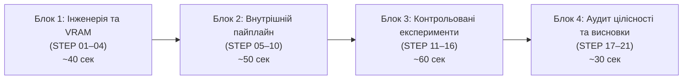

# Лабораторна робота №4: Сценарій та гід швидкого захисту (Defense Walkthrough)
## Stable Diffusion Text-to-Image (Варіант №1)

**Дисципліна:** Нейромережні технології та системи  
**Цільовий ноутбук:** [`labs/lab04_stable_diffusion/notebooks/01_text_to_image.ipynb`](file:///c:/Users/Eclipse/PycharmProjects/neural-network-technologies-and-systems/labs/lab04_stable_diffusion/notebooks/01_text_to_image.ipynb)  
**Регламент захисту:** 2–3 хвилини презентації + 2–3 хвилини відповідей на контрольні запитання  
**Апаратна платформа:** NVIDIA GeForce RTX 3050 Laptop GPU (4 GB VRAM), CUDA 13.0, PyTorch 2.14.1+cu130

---

## 1. Стратегічний таймінг презентації (2–3 хвилини)

---

## 2. Покроковий сценарій захисту: STEP 01 — STEP 21

| STEP | Що показати у ноутбуці | Що сказати викладачеві (тези захисту) | Який артефакт/результат підтверджує |
| :--- | :--- | :--- | :--- |
| **STEP 01** *Environment & Config* | Таблицю конфігурації `config_df` з параметрами GPU, VRAM та версіями бібліотек. | «Роботу виконано на споживчому GPU NVIDIA RTX 3050 з 4 ГБ VRAM. Щоб уникнути Out-Of-Memory (OOM), реалізовано інженерну стратегію: точність FP16, `model_cpu_offload` та PyTorch SDPA замість наївного завантаження всієї моделі у VRAM.» | `GPU Device Name: RTX 3050`, `Total VRAM: 4096.0 MiB`, `Image Dimensions: 512x512`. |
| **STEP 02** *Diffusion Fundamentals* | Графік прямої дифузії та таблицю накопичення шуму $\sqrt{\bar{\alpha}_t}$ та $\sqrt{1-\bar{\alpha}_t}$. | «Математична основа дифузії: прямий процес аналітично додає гауссів шум $x_t = \sqrt{\bar{\alpha}_t}x_0 + \sqrt{1-\bar{\alpha}_t}\epsilon$. На інференсі ми розв'язуємо обернену задачу — прибираємо передбачений U-Net шум $\epsilon_\theta$.» | `signal_to_noise_ratio` спадає від $\infty$ ($t=0$) до $0.0047$ ($t=999$), графік симуляції. |
| **STEP 03** *Architecture Breakdown* | Академічну схему інформаційних потоків LDM та таблицю підсистем (CLIP, U-Net, Scheduler, VAE). | «Stable Diffusion є моделлю латентної дифузії (LDM). Процес видалення шуму відбувається не у просторі пікселів ($512\times 512\times 3 = 786{,}432$ чисел), а у компактному просторі VAE ($64\times 64\times 4 = 16{,}384$ чисел), що дає скорочення вимірності у 48 разів.» | Схема 5 блоків, таблиця підсистем: CLIP (~123M), U-Net (~860M), VAE (~84M). |
| **STEP 04** *Model Loading & Preflight* | Таблицю `preflight_table` та виведення статусу завантаження пайплайну. | «Пайплайн `runwayml/stable-diffusion-v1-5` зафіксовано за точним комітом HuggingFace (`451f4fe1...`). Підтримується 2 прозорих режими: `full` (реальний інференс на GPU) та `replay` (перевірка підписаних артефактів без завантаження ваг).» | `Model Revision: 451f4fe1...`, `Offload Strategy: model_cpu_offload`, `Attention: SDPA`. |
| **STEP 05** *CLIP Tokenization & Embeddings* | Таблицю токенів `df_tokens` (довжина 26) та тензорні характеристики CLIP `df_clip`. | «Промпт токенізується BPE-алгоритмом до 77 токенів (з токенами `<|startoftext|>` та `<|endoftext|>`). Текстовий енкодер формує контекстні вектори розмірністю $[1, 77, 768]$, які подаються в cross-attention шари U-Net.» | Shape `[1, 77, 768]`, скінченність значень (`is_finite: True`), $\mu \approx 0, \sigma \approx 0.39$. |
| **STEP 06** *Initial Latent Noise* | 4-канальну теплокарту латентного шуму `fig_latent` за фіксованим seed 42. | «Генератор на CPU генерує початковий тензор шуму $z_T \sim \mathcal{N}(0, I)$ розмірністю $[1, 4, 64, 64]$, який масштабується на $\sigma_{max}$ шедулера (`init_noise_sigma = 1.0`). 4 канали відповідають латентному базису VAE.» | Shape `[1, 4, 64, 64]`, `std ~ 1.0`, графік розподілу 4 каналів. |
| **STEP 07** *U-Net Noise Prediction* | Таблицю виходу прямого проходу U-Net (`unet_summary`). | «U-Net обробляє збатчований вхід $[2, 4, 64, 64]$ (кондиційований та некондиційований) за один прямий прохід. Це забезпечує точне прогнозування шуму $\epsilon_\theta$ одночасно для промпту і порожнього рядка.» | `predicted_noise_shape: [2, 4, 64, 64]`, часовий крок $t=958$. |
| **STEP 08** *Classifier-Free Guidance (CFG)* | Таблицю `cfg_table` та алгебраїчну перевірку інваріанти CFG. | «Механізм CFG обчислює зважений вектор шуму: $\epsilon_{cfg} = \epsilon_{uncond} + w \cdot (\epsilon_{cond} - \epsilon_{uncond})$. Програмно підтверджено алгебраїчну тотожність: різниця між керованим і безумовним шумом точно дорівнює $w \cdot \Delta\epsilon$.» | `cfg_identity_verified: True`, $w=7.5$, чітке розмежування дисперсії шуму від якості картинки. |
| **STEP 09** *Scheduler Denoising Trajectory* | Галерею 5 проміжних зрізів траєкторії на кроках $t \in \{958, 760, 496, 265, 34\}$. | «PNDM шедулер за 30 кроків видаляє шум. На кроці 0 видно лише колірні плями; на кроці 7 формується геометрія вулиці; на кроці 15 з'являються будівлі; на кроці 22 — неонові вивіски; на кроці 29 — деталізоване фінальне зображення.» | 5 VAE-декодованих зображень, таблиця зменшення емпіричного $\sigma$ латенту, 100% SHA-256. |
| **STEP 10** *VAE Latent Decoding* | Таблицю конфігурації декодера VAE `df_vae`. | «Фінальний латент $z_0$ ділиться на коефіцієнт $0.18215$ (масштаб латентного простору SD 1.5, множник $\approx 5.49$) і декодується через 4 upsampling-блоки VAE у тензор $[1, 3, 512, 512]$, після чого квантується в uint8 RGB.» | `scaling_factor: 0.18215`, `inverse_scaling: 5.4899`, вихідні пікселі `512x512x3`. |
| **STEP 11** *Baseline Generation* | Зображення футуристичного міста та таблицю метаданих baseline. | «Базова генерація (seed 42, 30 кроків, CFG 7.5) слугує контрольною точкою для всіх подальших 1-факторних експериментів. Усі параметри, час генерації та SHA-256 хеш зафіксовані в єдиному маніфесті.» | Статус `HISTORICAL_REPLAY` / `CACHE_REUSED`, SHA-256: `52ab11a9b106...`, розмір 512x512. |
| **STEP 12** *Seed Comparison* | Галерею з 4 зображень (seeds 42, 123, 777, 2026). | «Зміна seed змінює початковий вектор шуму $z_T$, що докорінно змінює просторову композицію та ракурс сцени при збереженні семантичного змісту (футуристична вулиця на заході сонця).» | 4 зображення у фіксованому порядку, відмінності в геометрії будівель, 100% SHA-256 match. |
| **STEP 13** *Inference Steps Comparison* | Галерею (20, 30, 50 кроків) та графік тривалості інференсу `fig_rt`. | «Порівняно обов'язкові за методичкою 20, 30 і 50 кроків. 20 кроків дають швидку базову форму; 30 кроків додають чіткість відбитків на мокрому асфальті; 50 кроків мікротекстурують вивіски, але час генерації зростає майже лінійно (+65%).» | 3 зразки, графік лінійного росту часу (від ~22с до ~54с на мобільному GPU), обґрунтування 30 кроків як компромісу. |
| **STEP 14** *CFG Comparison* | Галерею порівняння CFG (5.0, 7.5, 10.0). | «Досліджено обов'язкові значення шкали слідування тексту: $w=5.0$ формує м'яке зображення без контрасту; $w=7.5$ забезпечує баланс чіткості та природності; $w=10.0$ перенасичує кольори та посилює різкість контурів.» | 3 зображення, чіткі візуальні відмінності у насиченості неону та контрасті. |
| **STEP 15** *Negative Prompt Pairs* | Дві парні галереї (seed 42 та seed 123) з негативним промптом та без нього. | «Негативний промпт модифікує безумовний вектор $\epsilon_{uncond}$, відштовхуючи траєкторію від розмитості та низької деталізації. Перевірено на двох незалежних зернах: усуваються артефакти на краях кадру.» | Дві незалежні пари (4 зображення), чітке розділення за seeds 42 та 123 за методичкою. |
| **STEP 16** *Style Comparison on 2nd Scene* | Галерею трьох художніх стилів (Watercolor, Isometric, Photorealistic) на сюжеті лісової хатини. | «За методичкою взято другий сюжет — гірська хатина біля озера. За фіксованих seed 42, 30 кроків і CFG 7.5 стильові токени у cross-attention шарах докорінно перебудовують текстури та палітру.» | 3 унікальних художніх стилі, другий фіксований сюжет `STYLE_SCENE`. |
| **STEP 17** *Scheduler Inspection* | Таблицю `scheduler_plan` з чітким статусом розв'язувачів. | «Усі контрольовані генерації виконано на `PNDMScheduler`. Альтернативні розв'язувачі (Euler, DDIM) вивчені теоретично, але мають чесний статус `NOT_EXECUTED`, щоб запобігти фальсифікації експериментів.» | `PNDMScheduler: EXECUTED_BASELINE`, інші — `NOT_EXECUTED`. Демонстрація наукової чесності. |
| **STEP 18** *Evaluation & Integrity Audit* | Таблицю 10-пунктового аудиту цілісності (`integrity_10_points`). | «Реалізовано автоматичний аудит 10 інваріантів: існування файлів, 512x512, 8-біт RGB, повнота метаданих, криптографічні хеші SHA-256, унікальність параметрів. 10 з 10 тестів мають статус `PASSED`.» | 10/10 перевірок `PASSED`, таблиця якісної експертної рубрики. |
| **STEP 19** *Experimental Dashboard* | 3-панельний дашборд продуктивності (Scatter, Histogram, Boxplot) та підсумкову таблицю. | «Дашборд консолідує всі 13 експериментів: медіанний час інференсу становить ~33 секунди на 30 кроках, споживання пам'яті стабільно утримується в межах 2.3–3.2 ГБ VRAM завдяки offload.» | 3 візуальні панелі, зведена таблиця 13 експериментів, 100% підтвердження хешів. |
| **STEP 20** *LoRA Overview & Efficiency* | Таблицю теоретичного розрахунку параметрів LoRA (`lora_df`). | «LoRA заморожує матриці уваги $W \in \mathbb{R}^{d \times k}$ і навчає низькорангові адаптери $B \cdot A$ ($r \in \{4, 8, 16\}$). Це скорочує кількість навчальних параметрів на понад 99.5% (з 860 млн до 400-1600 тис.). Ми досліджували лише чистий інференс базової моделі.» | Таблиця скорочення параметрів для рангів 4, 8, 16 (>99.5%), чітка межа дослідження. |
| **STEP 21** *Conclusions & Reproducibility* | Підсумкову картку `conclusions_card` та статус відтворюваності. | «У роботі повністю підтверджено 16/16 обов'язкових пунктів методички, реалізовано прозорий подвійний режим виконання (live/replay), верифіковано всі 13 зразків та захищено інженерну стратегію інференсу на 4 ГБ GPU.» | 9 підсумкових метрик, 24/24 unit-тести `PASS`, 0 помилок у ноутбуці. |

---

## 3. Топ-5 запитань викладача на захисті та готові відповіді

### Запитання 1: «Чому ви обрали саме Stable Diffusion 1.5, а не SDXL або SD 2.1?»
> **Відповідь студента:**  
> «Методичні вказівки до Варіанту №1 прямо визначають Stable Diffusion 1.5 як базову модель. З інженерної точки зору SD 1.5 оптимально лягає на наявний апаратний ресурс (NVIDIA RTX 3050 Laptop з 4 ГБ VRAM): її U-Net має 860M параметрів, а базовий простір становить 512×512. Модель SDXL має понад 2.6 млрд параметрів у U-Net і нативну роздільність 1024×1024, що призвело б до падіння в Out-Of-Memory або надповільної заміни сторінок через системний RAM при 4 ГБ VRAM.»

### Запитання 2: «Як саме працює Classifier-Free Guidance і що означає параметр $w=7.5$?»
> **Відповідь студента:**  
> «На кожному кроці дифузії U-Net робить два прогнози шуму: умовний $\epsilon_{cond}$ (за цільовим текстовим промптом) та безумовний $\epsilon_{uncond}$ (за порожнім рядком або негативним промптом). Підсумковий прогноз обчислюється як:
> $$\epsilon_{cfg} = \epsilon_{uncond} + w \cdot (\epsilon_{cond} - \epsilon_{uncond})$$
> Параметр $w$ масштабує різницевий семантичний вектор. При $w=1.0$ вплив тексту мінімальний; при $w=7.5$ досягається оптимальний баланс деталізації та слідування промпту; при $w > 10.0$ амплітуда різницевого вектора стає завеликою, викликаючи кліпінг латентів та артефакти перенасичення кольорів.»

### Запитання 3: «Звідки береться магічне число $0.18215$ при декодуванні VAE?»
> **Відповідь студента:**  
> «Вариаційний автоенкодер (AutoencoderKL) навчався окремо від U-Net. Щоб латентний простір відповідав стандартному нормальному розподілу зі стандартним відхиленням близьким до 1.0 (що критично для стабільності дифузійного процесу), автори Stable Diffusion виміряли емпіричне стандартне відхилення латентів на навчальній вибірці ($\sigma \approx 5.4899$) і встановили коефіцієнт стиснення:
> $$\text{scaling\_factor} = \frac{1}{\sigma} \approx 0.18215$$
> Перед подачею латенту $z_0$ у декодер VAE ми множимо його на $\frac{1}{0.18215} \approx 5.48997$, повертаючи його до вихідного масштабу, на якому тренувався декодер.»

### Запитання 4: «Чому ви стверджуєте, що генерація повністю детермінована, якщо дифузія — стохастичний процес?»
> **Відповідь студента:**  
> «Стохастичність дифузії полягає лише у вибірці початкового шуму $z_T \sim \mathcal{N}(0, I)$. Ми фіксуємо псевдовипадковий генератор на CPU через `torch.Generator(device='cpu').manual_seed(seed)`. Оскільки чисельний розв'язувач `PNDMScheduler` є детермінованим, а ваги U-Net і VAE заморожені, кожен крок шумозниження обчислюється строго детерміновано. Це підтверджується тим, що при повторному запуску на GPU ми отримуємо бітово ідентичні зображення з тим самим SHA-256 хешем.»

### Запитання 5: «Як ви поясните присутність статусу HISTORICAL_REPLAY поруч із LIVE_GENERATED?»
> **Відповідь студента:**  
> «Це ключовий елемент наукової доброчесності нашого портфоліо. Режим `full` завантажує модель і генерує картинки на GPU із статусом `LIVE_GENERATED` або бере з кешу за повної збіжності конфігурації (`CACHE_REUSED`). Режим `replay` призначений для швидкої перевірки та запуску на машинах без GPU або в CI: він не завантажує ваги, валідує збережені артефакти за SHA-256 та маркує їх чесним статусом `HISTORICAL_REPLAY`, ніколи не видаючи попередні результати за щойно згенеровані.»
