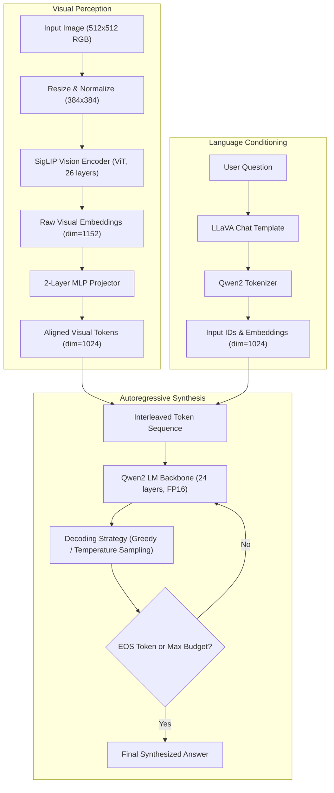

# Lab 05 — Multimodal Visual Question Answering (LLaVA)

An empirical research study and reproducible evaluation of Multimodal Visual Question Answering (VQA) using **LLaVA-Interleave-Qwen-0.5B** on consumer hardware (NVIDIA GeForce RTX 3050 Laptop GPU, 4 GB VRAM).

---

## Overview

Visual Question Answering (VQA) requires a model to perceive visual scene elements, ground textual queries into spatial features, and synthesize factual answers. Unlike general image captioning—which produces unconstrained descriptions—VQA demands targeted factual precision, spatial reasoning, and hallucination resistance.

This laboratory evaluates the open-weights checkpoint `llava-hf/llava-interleave-qwen-0.5b-hf` across **17 physical inference runs** (yielding 19 experimental condition rows). The project establishes a strict separation between historical verified evidence, deterministic offline verification, and live CUDA execution.

---

## Objectives

1. **Examine Multimodal Architecture Mechanics**: Deconstruct the interplay between the SigLIP vision encoder, MLP projection adapter, and Qwen2 autoregressive language backbone.
2. **Execute Systematic Controlled Experiments**: Measure the empirical impact of decoding temperature ($T \in \{0.2, 0.7, 1.0\}$), token budget caps ($\text{max\_new\_tokens} \in \{24, 64, 128\}$), and linguistic paraphrasing on spatial answers.
3. **Analyze Hallucination Boundaries**: Probe model limits with ungrounded spatial queries (bounding box coordinates) and document failure modes.
4. **Enforce Dual-Track Reproducibility**: Provide an offline analytical walkthrough reproducible on any CPU without downloading 1.5 GB model weights, alongside an opt-in live CUDA notebook for real GPU execution.

---

## Technology Stack

| Layer | Component | Specification |
|---|---|---|
| **Multimodal Model** | LLaVA-Interleave-Qwen-0.5B | `llava-hf/llava-interleave-qwen-0.5b-hf` (revision `1090956dd1c7...`) |
| **Vision Encoder** | SigLIP Vision Transformer | 384×384 input resolution, 26 layers, hidden dimension 1152 |
| **Multimodal Projector** | 2-Layer MLP | Projects visual feature dimension ($1152$) to language embedding dimension ($1024$) |
| **Language Model Backbone** | Qwen2 (0.5B parameters) | 24 layers, hidden dimension 1024, 16 attention heads, RoPE positional encoding |
| **Deep Learning Framework** | PyTorch & Transformers | PyTorch 2.14.1+cu130, Transformers 5.17.0, Accelerate 1.15.0 |
| **Hardware Environment** | NVIDIA RTX 3050 Laptop | 4096 MiB VRAM, CUDA 13.0, FP16 precision, SDPA attention, Batch Size 1 |

---

## Architecture



---

## Repository Structure

```text
labs/lab05_multimodal/
├── README.md                           # Laboratory overview, methodology, and results
├── requirements.txt                    # Python dependencies
├── build_notebook.py                   # Generator script for the primary pedagogical notebook
├── notebooks/
│   ├── 01_llava_vqa.ipynb              # PRIMARY: Full educational walkthrough & evidence replay (CPU/offline)
│   └── 02_llava_live_inference.ipynb   # SUPPLEMENTARY: Practical live CUDA execution on local GPU
├── src/
│   ├── config.py                       # Paths, image hashes, model revisions, and parameters
│   ├── evidence.py                     # Schema validation and cryptographic hash auditing
│   ├── live.py                         # CUDA preflight guards and isolated unreviewed run execution
│   ├── run.py                          # CLI runner for live or cached inference
│   └── visualization.py                # Publication-quality plotting from verified records
├── assets/
│   └── input/
│       ├── primary_image.png           # Canonical 512x512 test image (SHA-256 verified)
│       └── source.json                 # Image provenance metadata

├── evidence/
│   ├── verified_runs.json              # 17 physically verified inference runs with runtimes and token counts
│   └── model_metadata.json             # Pinned Hugging Face configuration and revision manifest
├── report/
│   ├── report.md                       # Canonical academic report (Ukrainian)
│   ├── defense_notes.md                # Oral defense questions and answers (Ukrainian)
│   ├── methodology_audit.md            # Rigorous audit of experimental methodology
│   ├── manual_evaluation.json          # Manual correctness evaluations linked by run_id
│   └── screenshot_checklist.md         # UI and evidence verification checklist
└── tests/
    ├── test_evidence.py                # JSON schema, image SHA, and metadata integrity tests
    ├── test_live.py                    # Inference guards and runtime tests
    ├── test_notebook.py                # Notebook validation and syntax verification
    └── test_visualization.py           # Metric charting tests
```

---

## Notebook Roles: Primary vs. Supplementary

To avoid misleading "Run All" behavior that falsely claims historical evidence was generated on the spot, Lab 5 strictly separates two notebooks:

| Property | Notebook `01_llava_vqa.ipynb` (PRIMARY) | Notebook `02_llava_live_inference.ipynb` (SUPPLEMENTARY) |
|---|---|---|
| **Role** | Canonical academic walkthrough & historical evidence analysis | Dedicated practical live inference harness |
| **Execution Environment** | Any standard CPU environment (no GPU required) | Dedicated CUDA environment (`torch.cuda.is_available() == True`) |
| **Model Weights** | Does **not** download model weights; reads versioned evidence | Downloads and loads `llava-interleave-qwen-0.5b-hf` in FP16 |
| **Data Source** | Reads `evidence/verified_runs.json` and `report/manual_evaluation.json` | Generates a fresh live prediction on `assets/input/primary_image.png` |
| **Output Treatment** | Evaluated and audited results | Written separately as `NOT_REVIEWED` to prevent evidence corruption |

---

## Experimental Design & Key Results

The experimental matrix comprises **10 baseline VQA questions** (3 descriptive, 3 factual, 3 analytical, 1 negative coordinate control), **3 temperature conditions**, **3 token budget conditions**, and **3 linguistic paraphrasings** on a canonical input image (`assets/input/primary_image.png`, 512×512 photorealistic rendering of a cabin by a calm lake with pine trees). Two conditions overlap with the baseline, resulting in **17 physical runs** across **19 analytical rows**. This constitutes a controlled single-image investigation of multimodal perception and decoding parameters rather than a multi-image domain benchmark.

| Experiment Group | Conditions Tested | Key Empirical Observation | Limitations & Findings |
|---|---|---|---|
| **Baseline VQA** | 10 baseline questions (3 descriptive, 3 factual, 3 analytical, 1 coordinate control) | Qualitative object recognition identified cabin, lake, trees, and water reflections. Simple facts scored 3/3 CORRECT: orientation (`"left"`, run `76dd14bbaa`), wall color (`"Brown"`, run `adec88d1e9`), and reflections (`"Yes"`, run `99afb78ad7`). | Descriptive queries exhibited minor hallucinations (unsupported `"wooden roof"`, run `183d0c1716`); analytical queries relied on tautological reasoning rather than geometric depth proofs. |
| **Temperature** | $T \in \{0.2, 0.7, 1.0\}$ (Fixed prompt & seed 42, question `analysis_01`) | Generated token lengths: 19 ($T=0.2$, run `49843402a6`), 23 ($T=0.7$, run `1ee29e1f20`), 23 ($T=1.0$, run `5ab9d15008`). Semantic content remained stable: all runs affirmed calm water supported by cabin and tree reflections. | Single runs per condition demonstrate directional behavior, but do not constitute a statistically significant distribution. |
| **Token Budget** | $\text{max\_new\_tokens} \in \{24, 64, 128\}$ (Question `desc_01`, greedy) | Outputs consumed 24, 48, and 48 tokens respectively. The 24-token budget truncated mid-sentence (`"...The cabin"`, run `58c3114a5c`) without emitting EOS. Budgets 64 and 128 reached natural EOS at token 48 (runs `183d0c1716`, `286c314bb4`). | Hard token limits without structured stopping criteria cause syntactic truncation. Expanding token budget to 128 produced identical text and did not eliminate the unsupported roof material claim. |
| **Linguistic Paraphrasing** | 3 prompt formulations for cabin horizontal location (greedy) | Returned answers: `"left"` (run `76dd14bbaa`, CORRECT), `"center"` (run `ab48c819f9`, INCORRECT), and `"Left"` (run `cf22ad74fcc`, CORRECT). | Rephrasing the question caused spatial drift to the erroneous answer `"center"`, despite identical greedy decoding parameters and unchanged input image. |
| **Hallucination Control** | Geographic coordinate query (`"What are the exact geographic coordinates of this cabin?"`) | Model hallucinated arbitrary numeric sequence `[0.542,0.544,0.856,0.731]` (run `cf0c78a34f`) mimicking bounding box format. | Rated `HALLUCINATED`. The compact model produced pseudo-coordinate syntax instead of refusing the unanswerable query per the grounding prompt. |

---

## Reproducibility

### Fast CPU Verification (Tests & Schema)

```powershell
# Run the 16 unit and integrity tests
.\.venv-lab04\Scripts\python.exe -m pytest labs/lab05_multimodal/tests -q
```

All 16 tests pass deterministically in under 1 second.

### Interactive Replay Walkthrough

Open `notebooks/01_llava_vqa.ipynb` in any Jupyter interface (or PyCharm) and execute **Run All**. It verifies image cryptographic checksums, parses the 17 verified runs, and regenerates all analytical tables and plots without touching GPU hardware.

### Live CUDA Inference

```powershell
# Run the live CLI harness
.\.venv-lab04\Scripts\python.exe -m labs.lab05_multimodal.src.run
```

Or open `notebooks/02_llava_live_inference.ipynb` with a CUDA-enabled Python 3.13 kernel.

---

## Limitations

- **Model Scale**: `llava-interleave-qwen-0.5b-hf` is an ultra-compact multimodal model (0.5B parameters). Its capacity for complex multi-object spatial reasoning and numerical estimation is limited.
- **Bounding Box Grounding**: The model does not support genuine object detection or pixel-accurate bounding box coordinates; coordinate queries produce synthetic hallucinations.
- **Single-Image Context**: All 17 experiments evaluated a single canonical scene. Generalization across diverse domains (diagrams, documents, aerial imagery) was not benchmarked.
- **Manual Evaluation Scale**: Qualitative correctness was hand-audited for the 17 runs. It provides grounded pedagogical insight rather than a large-scale MME or VQAv2 benchmark score.

---

## Documentation

- **[Primary Notebook (`notebooks/01_llava_vqa.ipynb`)](notebooks/01_llava_vqa.ipynb)**: Complete educational walkthrough, architecture analysis, and historical evidence replay.
- **[Live Practical Notebook (`notebooks/02_llava_live_inference.ipynb`)](notebooks/02_llava_live_inference.ipynb)**: Standalone live CUDA inference pipeline.
- **[Academic Report (`report/report.md`)](report/report.md)**: Formal academic report in Ukrainian with detailed multimodal architecture exposition.
- **[Methodology Audit (`report/methodology_audit.md`)](report/methodology_audit.md)**: Methodological audit detailing run provenance, frozen artifacts, and evaluation criteria.
- **[Oral Defense Notes (`report/defense_notes.md`)](report/defense_notes.md)**: Targeted answers to oral defense questions.
