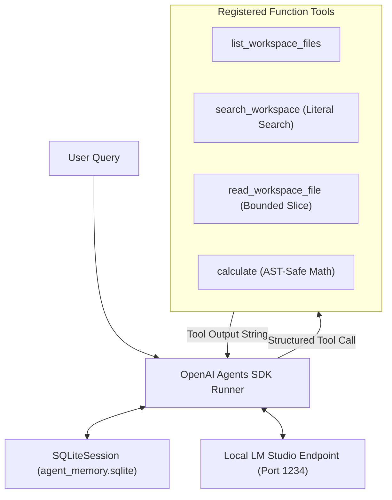

# Lab 06 — Autonomous LLM Agent with Tool Calling & Structured Memory

A reproducible engineering study and empirical evaluation of an autonomous, tool-using AI Agent built with the **OpenAI Agents SDK** and served locally via **LM Studio** (`mistralai/ministral-3-3b`), featuring AST-sandboxed arithmetic and persistent SQLite session memory.



---

## Overview

Unlike single-turn conversational LLM prompts, an autonomous agent executes a dynamic reasoning loop: the model inspects registered tool schemas, generates structured function call requests, receives tool execution results from the runtime, and iteratively decides whether to request additional tools or emit a final user-facing response.

In this laboratory (Variant 3: OpenAI Agents SDK), the agent acts as a local engineering assistant tasked with analyzing real laboratory reports (Labs 3–5), verifying numerical calculations, and maintaining conversation history across multi-turn sessions without cloud telemetry or external internet access.

---

## Objectives

1. **Implement Agent Execution Lifecycle**: Construct an autonomous ReAct loop using `openai-agents` 0.22.3, managing tool declarations, structured arguments, turn limits ($\le 10$), and tool result feedback.
2. **Develop Sandboxed Local Tools**: Implement four bounded, deterministic function tools: directory listing, literal case-insensitive file searching, bounded line reading, and an AST-based safe arithmetic evaluator.
3. **Persist Multi-Turn Session Memory**: Integrate `SQLiteSession` to isolate conversations by `session_id`, verifying history recall and cross-session isolation.
4. **Quantify Tool Utility vs. Direct Generation**: Empirically contrast answers generated with tools against answers generated without tools across identical queries.
5. **Analyze Failure Modes**: Document execution errors, missed tool calls, incorrect file naming, and hallucinated calculations honestly in a versioned audit.

---

## Technology Stack

| Layer | Component | Specification |
|---|---|---|
| **Agent Framework** | OpenAI Agents SDK | `openai-agents` 0.22.3, `openai` 3.17.0 |
| **Local Inference Host** | LM Studio (v1 API) | `http://localhost:1234/v1` (Chat Completions protocol) |
| **Evaluated Model** | Ministral 3B / Mistral 7B | Local GGUF quantized models supporting native function calling |
| **Conversation Memory** | SQLiteSession | Thread-safe SQLite database (`agent_memory.sqlite`), indexed by `session_id` |
| **Arithmetic Engine** | Python AST Evaluator | Safe recursive AST walker supporting `+`, `-`, `*`, `/`, `**` (rejects arbitrary code execution) |
| **Runtime Environment** | Python 3.13 | Fully local loopback networking; cloud telemetry and tracing disabled |

---

## Architecture

The system coordinates the agent lifecycle through the SDK `Runner`:

1. **Preflight**: Validates the local loopback endpoint (`/v1/models`) and confirms tool-calling support.
2. **Context Assembly**: The `Runner` loads previous conversation turns for the current `session_id` from SQLite and appends the system instruction prompt.
3. **Reasoning & Tool Selection**: The LLM outputs either text content or a JSON function call matching registered Pydantic schemas.
4. **Execution & Feedback**: The runtime executes the local Python function and delivers the return string back to the model as a `tool` role message.
5. **Termination**: The cycle repeats until the model produces a final text answer or reaches the `max_turns=10` limit.

### Registered Tools

| Tool Function | Description | Safety & Boundary Constraints |
|---|---|---|
| `list_workspace_files` | Returns names and byte sizes of files in `assets/workspace/`. | Strictly restricted to the sandboxed workspace directory; no parent path traversal (`..`). |
| `search_workspace` | Case-insensitive literal substring search returning matching line numbers and snippets. | Literal string matching (not regex); limits maximum matches to prevent context window overflow. |
| `read_workspace_file` | Reads a bounded slice of lines from a workspace file. | Enforces maximum line limits (e.g., 100 lines); rejects binary or unauthorized files. |
| `calculate` | Evaluates arithmetic expressions using Python's `ast` module. | Restricts operations to numeric literals and basic math operators; blocks builtins, imports, and `eval`. |

---

## Repository Structure

```text
labs/lab06_agents/
├── README.md                           # Laboratory overview, architecture, and results
├── requirements.txt                    # Exact library dependencies
├── build_practical_notebook.py         # Generator script for the primary pedagogical notebook
├── notebooks/
│   └── 01_openai_agents_sdk.ipynb      # PRIMARY: Complete educational walkthrough (LIVE & REPLAY modes)
├── src/
│   ├── config.py                       # Settings, paths, and environment validation
│   ├── preflight.py                    # LM Studio endpoint probe and readiness checks
│   ├── tools.py                        # Registered tool functions (AST math, search, read, list)
│   ├── agent.py                        # Agent factory, system prompt, and Runner harness
│   ├── experiments.py                  # Controlled test scenario matrix execution
│   └── reporting.py                    # Evaluation report and metrics compilation
├── assets/
│   └── workspace/                      # Controlled report copies (Labs 3, 4, 5) and SHA manifest
├── outputs/
│   ├── runs/runs.jsonl                 # Logged execution metadata for completed runs
│   ├── traces/                         # Raw JSON execution traces of tool calls and responses
│   └── metadata/                       # Preflight records, batch IDs, and environment state
├── report/
│   ├── report.md                       # Canonical academic report (Ukrainian)
│   ├── defense_notes.md                # Oral defense Q&A preparation notes (Ukrainian)
│   ├── methodology_audit.md            # In-depth methodology and prompt engineering audit
│   ├── notebook_overhaul_audit.md      # Detailed audit of notebook state and provenance
│   ├── repository_audit.md             # Baseline repository structure audit
│   └── manual_evaluation.json          # Manual correctness evaluations linked by run_id
└── tests/
    ├── test_agent.py                   # Agent loop, mock runner, and execution lifecycle tests
    ├── test_notebook.py                # Primary notebook validation and syntax checks
    ├── test_scenarios.py               # Scenario definition and evaluation tests
    └── test_tools.py                   # AST calculator safety and workspace tool tests
```

---

## Experimental Design & Scenarios

The evaluation executes a controlled matrix of multi-turn scenarios designed to test diverse operational capabilities:

1. **Direct Lookup**: Single-step factual query requiring `search_workspace` or `read_workspace_file` (e.g., locating exact checkpoint revisions).
2. **Cross-Document Synthesis**: Comparing findings across multiple laboratory reports (e.g., comparing Lab 4 image counts with Lab 5 VQA counts).
3. **Numerical Reasoning**: Extracting facts from text and computing mathematical relationships via `calculate` (e.g., computing the difference between 17 and 13).
4. **Session Memory & Recall**: Storing a user-defined alias in Turn 1 and recalling it in Turn 2 without repeating the name.
5. **Session Isolation**: Verifying that a separate `session_id` cannot access facts from another user's session.
6. **Unsupported Information**: Requesting out-of-corpus data (e.g., weather in Paris); verifying refusal rather than hallucination.
7. **With-Tools vs. Without-Tools Control**: Demonstrating that without tools, the model hallucinates plausible-sounding but incorrect numbers; with tools, it verifies facts from the reports.

---

## Key Results & Error Analysis

| Dimension | Measured Outcome | Empirical Analysis |
|---|---|---|
| **Tool Usage Utility** | Without Tools: **FAIL** (Hallucination)<br/>With Tools: **PASS** (Grounded) | Without tools, the local 3B model guessed arbitrary numbers for lab runs. With tools enabled, the model systematically invoked `search_workspace`, verified exact counts (13 for Lab 4, 17 for Lab 5), and used `calculate` to compute the difference ($17 - 13 = 4$). |
| **Session Isolation** | **100% Isolation** across sessions | Queries in `session_B` returned no trace of data stored in `session_A`, proving SQLite transaction boundary enforcement. |
| **Tool Call Precision** | 100% Valid JSON signatures | The local model adhered to tool argument schemas without argument formatting errors. |
| **Observed Failure Modes** | Omitted Tool Calls & Redundant Searches | In early iterations with ambiguous prompts, the model occasionally performed mental arithmetic instead of calling `calculate`, or repeated identical search queries. Updating system instructions to mandate tool verification resolved this behavior. |

---

## Provenance and Replay Status

When inspecting historical records in `notebooks/01_openai_agents_sdk.ipynb`, the notebook displays the provenance status:

> `REPLAY_UNVERIFIED_WORKSPACE_MISMATCH`

### What This Status Means:
- **Historical Evidence**: The recorded traces in `outputs/runs/runs.jsonl` and `outputs/traces/` represent genuine, physical runs executed against LM Studio.
- **Workspace Drift**: The audit harness computes the current SHA-256 hash of all files in `assets/workspace/` and compares it to the hash recorded when the batch was executed. Because the workspace reports were lightly edited after the batch completed, the hashes do not match.
- **Integrity Guarantee**: Rather than silently ignoring this difference or fabricating a new "PASS", the system honestly flags the condition as `WORKSPACE_MISMATCH`. The underlying traces remain authentic and auditable.

---

## Reproducibility

### Fast Offline Test Suite

```powershell
# Run the 33 unit and safety tests
.\.venv-lab06\Scripts\python.exe -m pytest labs/lab06_agents/tests -q
```

All 33 tests pass deterministically in ~3.5 seconds.

### Replay Mode (Notebook Inspection)

Open `notebooks/01_openai_agents_sdk.ipynb` in any Jupyter viewer. The notebook executes preflight checks and analyzes historical traces, reproducing all evaluation tables without requiring LM Studio to be online.

### Live Mode (Local LM Studio Inference)

1. Launch **LM Studio** and start the local server on `http://localhost:1234`.
2. Load a model supporting tool calling (e.g., `mistralai/ministral-3-3b` or `qwen2.5-7b-instruct`).
3. Set the live execution flag in PowerShell:
   ```powershell
   $env:LAB06_RUN_FULL_LIVE = "1"
   ```
4. Run the preflight script and experiment suite:
   ```powershell
   .\.venv-lab06\Scripts\python.exe -m labs.lab06_agents.src.preflight
   .\.venv-lab06\Scripts\python.exe -m labs.lab06_agents.src.experiments
   ```

---

## Limitations

- **Small Model Scale (3B parameters)**: The local model occasionally requires explicit instruction prompting to avoid skipping arithmetic tool calls.
- **Keyword Search Constraints**: `search_workspace` performs literal substring matching. Queries using synonyms not present in the text will miss relevant sections (addressed by hybrid retrieval in Lab 7).
- **Single-Agent Scope**: The architecture implements a single ReAct agent with tools; hierarchical multi-agent handoffs or parallel swarms are not included.
- **Local Dependency**: Live execution is strictly dependent on the host machine having sufficient RAM/VRAM to host LM Studio locally.

---

## Documentation

- **[Primary Notebook (`notebooks/01_openai_agents_sdk.ipynb`)](notebooks/01_openai_agents_sdk.ipynb)**: Pedagogical walkthrough covering environment preflight, tool registration, ReAct lifecycle, memory persistence, and failure analysis.
- **[Academic Report (`report/report.md`)](report/report.md)**: Canonical academic report in Ukrainian detailing agent architecture, prompt design, and empirical observations.
- **[Oral Defense Notes (`report/defense_notes.md`)](report/defense_notes.md)**: Targeted answers to oral defense questions.
- **Supplementary Audits**:
  - [Methodology Audit (`report/methodology_audit.md`)](report/methodology_audit.md)
  - [Notebook Overhaul Audit (`report/notebook_overhaul_audit.md`)](report/notebook_overhaul_audit.md)
  - [Repository Audit (`report/repository_audit.md`)](report/repository_audit.md)
