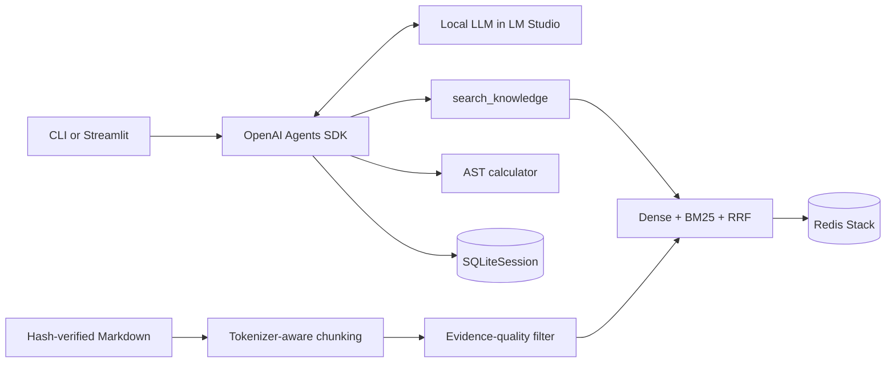
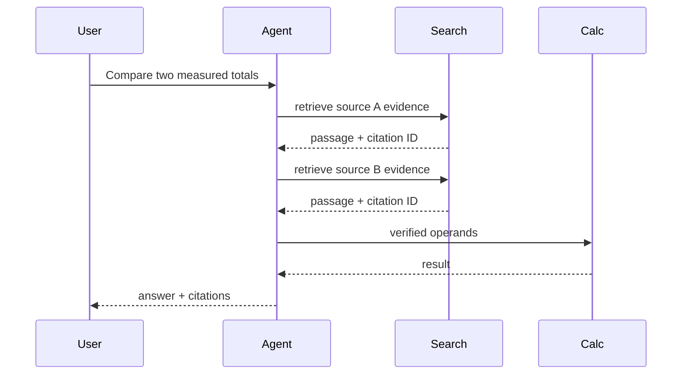
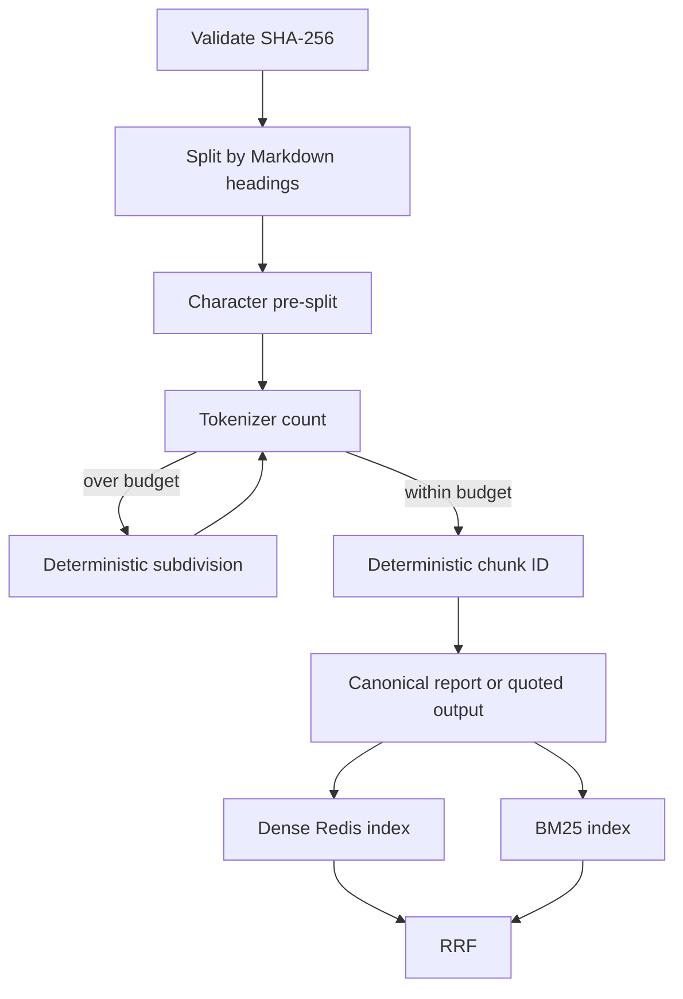

# Local Coursework Knowledge Assistant

An offline-first assistant for querying and comparing verified reports from Labs 3–6. It retrieves report passages, exposes tool calls, validates citation IDs against the current run, performs bounded arithmetic, and keeps isolated SQLite conversation sessions. It is a coursework system, not a production service.

Historical results exposed weak Ukrainian retrieval and incorrect multi-step synthesis. The current revision addresses ingestion and retrieval defects, but new live quality claims remain unverified until Redis, LM Studio, and the evaluation suite run together.

## Architecture





| Component | Responsibility |
|---|---|
| `src/knowledge_base.py` | Corpus hashes, deterministic IDs, token budget, Redis dense search, BM25, RRF |
| `src/agent.py` | Local model, SDK Runner, SQLite sessions, traces, citation membership |
| `src/tools.py` | Bounded retrieval, source listing, AST-only arithmetic |
| `src/experiments.py` | Fixed splits, evidence Recall@k, MRR, latency, live comparisons |
| `app.py` / `web_app.py` | CLI and Streamlit interfaces over the same services |

## Ingestion and retrieval



Quoted model responses under result sections remain in the academic report but are excluded from retrieval candidates. This conservative rule is not a semantic truth classifier.

## Windows 11 setup

Requirements: Python 3.11+, an existing compatible PyTorch environment, Docker Desktop with Linux containers, LM Studio, and a tool-capable local chat model. The historical model was `mistralai/ministral-3-3b`; availability must be checked locally.

```powershell
cd C:\path\to\neural-network-technologies-and-systems
.\labs\lab07_final_project\setup.ps1 -Python .\path\to\working-python.exe
docker compose -f labs/lab07_final_project/docker-compose.yml up -d
Invoke-RestMethod http://localhost:1234/v1/models
$env:LM_STUDIO_MODEL = "mistralai/ministral-3-3b"
```

MiniLM remains the historical baseline. A multilingual candidate can be configured with exact model and revision, then compared on the same evaluation split. No improvement is claimed before measurement.

## Run and verify

```powershell
# CLI
.\labs\lab07_final_project\.venv\Scripts\python.exe labs/lab07_final_project/app.py --debug
# Web UI
.\labs\lab07_final_project\.venv\Scripts\python.exe -m streamlit run labs/lab07_final_project/web_app.py
# Retrieval evaluation
.\labs\lab07_final_project\.venv\Scripts\python.exe -m labs.lab07_final_project.src.experiments --retrieval-only
# Live agent suite
.\labs\lab07_final_project\.venv\Scripts\python.exe -m labs.lab07_final_project.src.experiments --force
# Offline tests
.\labs\lab07_final_project\.venv\Scripts\python.exe -m pytest labs/lab07_final_project/tests -q
```

## Demonstration

1. Document Q&A: request the exact Lab 4 Stable Diffusion checkpoint and revision; inspect the passage and citation.
2. Cross-document arithmetic: request the difference and sum of Lab 4 unique generations and Lab 5 unique inference runs; the trace must show both retrievals and a real `calculate` call.
3. Unsupported information and memory: request an undocumented outdoor temperature, then test a follow-up in the same session and a fresh session.

Screenshots are `MANUAL`: capture the answer, expanded tool/evidence panel, Redis health, LM Studio model list, and unsupported-query refusal. Do not substitute mocks.

## Verified status and limitations

The historical batch reported Source Hit@5 `6/7`, with assistant answers `3 CORRECT`, `3 PARTIAL`, `4 INCORRECT`, `1 NOT_SCORABLE`; 76/121 MiniLM chunks exceeded its token limit. These results remain historical evidence.

Current offline checks cover deterministic chunking, token budgets, corpus hashes, arithmetic restrictions, citation membership, memory isolation, notebook schema, and UI syntax. Current live evidence Recall@5, correctness, orchestration, and latency are `NOT_VERIFIED` because Docker/Redis and LM Studio were unavailable during this revision. Offline tests are not live E2E.

- RRF adds lexical robustness for model IDs and numbers without a reranker.
- Literal evidence labels are transparent but miss valid paraphrases.
- Citation membership blocks fabricated IDs; it does not prove entailment.
- The section filter may exclude useful diagnostic prose.
- SQLite is suitable for a single-user demo, not multi-tenant deployment.
- No shell, arbitrary filesystem tool, cloud fallback, or remote endpoint is exposed.

See [the acceptance audit](../../docs/audits/FINAL_PORTFOLIO_ACCEPTANCE.md).
