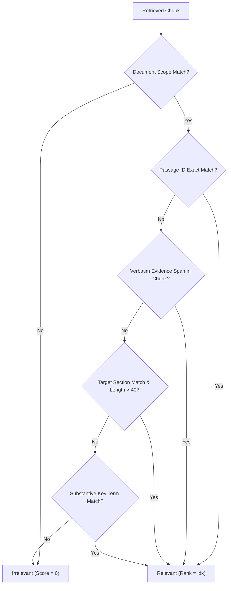

# Scientific Annotation Procedure and Evaluation Protocol
## Ground Truth Methodology for Local Engineering Knowledge Copilot (Lab 7)

**Document Version:** 1.0.0  
**Status:** Approved Standard  
**Target:** Local Agentic RAG System Evaluation  

---

## 1. Objective and Scientific Rationale

Reliable evaluation of Retrieval-Augmented Generation (RAG) systems requires grounded, reproducible, and verifiable evidence standards. Historical reliance on unconstrained token-overlap heuristics (such as 75% bag-of-words overlap) creates false positive risks where off-topic paragraphs sharing technical jargon receive artificial relevance credit.

This document establishes the scientific annotation protocol, ground truth passage identification rules, and dataset governance model for the **Local Engineering Knowledge Copilot**.

---

## 2. Dataset Split Architecture

To prevent data snooping and target overfitting, the evaluation corpus is strictly partitioned into two independent sets:

| Split Identifier | Query Count | Purpose | Optimization Policy |
| :--- | :--- | :--- | :--- |
| **`dev_eval_50.json`** | 51 queries | Development, parameter tuning, error analysis | Open for feature engineering, BM25 weight tuning, and router iteration. |
| **`acceptance_eval_50.json`** | 49 queries | Independent acceptance gate and final certification | **Frozen and untouched.** Evaluated strictly once without post-hoc hyperparameter adjustments. |

### Distribution by Category

Each split preserves balanced coverage across 5 functional categories:
1. **Exact Fact (`exact_fact`)**: Single-hop factual queries requiring exact architectural constants, configuration keys, or quantitative specifications.
2. **Semantic Paraphrase (`semantic_paraphrase`)**: Queries formulated with colloquial phrasing, synonyms, or cross-lingual terms (Ukrainian technical terminology vs. English source headers).
3. **Cross-Document (`cross_document`)**: Multi-hop comparison queries requiring synthesized evidence from two or more distinct laboratory reports or specifications.
4. **Numerical Reasoning (`numerical_reasoning`)**: Queries requiring calculation (e.g. latency deltas, throughput ratios, budget percentages) over retrieved tabular or numerical constants.
5. **Unsupported / Refusal (`unsupported_refusal`)**: Out-of-scope or out-of-distribution queries for which the corpus contains zero supporting evidence; the agent must explicitly refuse.

---

## 3. Evidence Annotation Standard

### 3.1 Stable Passage Identifier (`passage_id`)
Every chunk generated during ingestion is assigned a deterministic, immutable identifier:
$$\text{chunk\_id} = \langle\text{document\_id}\rangle\text{\_chunk\_}\langle\text{ordinal:03d}\rangle$$

Examples:
- `adr_001_vector_and_storage_architecture_chunk_001`
- `lab04_model_adaptation_chunk_004`
- `incident_postmortem_oom_chunk_002`

### 3.2 Verbatim Evidence Span (`evidence_spans`)
For every supported query, human annotators mark the exact, minimal contiguous string that proves the claim.
- **Rule of Minimality**: The evidence span must not include extraneous narrative sentences.
- **Verbatim Requirement**: The span must match verbatim against the source markdown document, including mathematical notation and unit names.
- **Multi-Document Requirement**: Cross-document queries must provide at least one distinct evidence span for *each* required source document.

### 3.3 Target Section Header (`target_sections`)
Annotators record the canonical Markdown heading level 2 (`##`) or level 3 (`###`) where the evidence resides.

---

## 4. Multi-Level Relevance Judgment Algorithm

In `evaluation/metrics.py`, relevance is judged hierarchically:



1. **Document Scope Gate**: If the chunk belongs to an unrelated document, it is immediately disqualified.
2. **Passage ID Match**: If `chunk.chunk_id` matches `gold_passage_ids`, it is marked relevant with 100% confidence.
3. **Verbatim Span Match**: If `evidence_span in normalize(chunk.text)`, it is marked relevant.
4. **Section Alignment**: If `normalize(chunk.section) in target_sections` and the chunk contains substantive prose (>40 chars), it is marked relevant.
5. **Substantive Token Overlap Fallback**: Only used for legacy test items, requiring $\ge 75\%$ overlap on non-stopword tokens.

---

## 5. Metrics Specification and Formulas

### 5.1 Evidence Recall@k
For single-document queries:
$$\text{Recall@}k = \begin{cases} 1.0 & \text{if } \exists c \in \text{Top-}k \text{ s.t. } \text{IsRelevant}(c) \\ 0.0 & \text{otherwise} \end{cases}$$

For cross-document queries requiring set $D_{\text{gold}}$ of documents:
$$\text{Recall@}k = \frac{|\{d \in D_{\text{gold}} \mid \exists c \in \text{Top-}k, c.\text{doc\_id} = d \land \text{IsRelevant}(c)\}|}{|D_{\text{gold}}|}$$

### 5.2 Hit@5
$$\text{Hit@5} = \begin{cases} 1.0 & \text{if at least 1 relevant passage is retrieved in top 5} \\ 0.0 & \text{otherwise} \end{cases}$$

### 5.3 Mean Reciprocal Rank (MRR)
$$\text{MRR} = \frac{1}{|Q|} \sum_{q=1}^{|Q|} \frac{1}{\min(\{r \mid c_r \text{ is relevant}\} \cup \{\infty\})}$$

---

## 6. Model and Pipeline Configuration Fingerprint

All reported benchmarks must execute against the following frozen configuration:

```yaml
rag_pipeline_fingerprint:
  embedding_model: "intfloat/multilingual-e5-small"
  embedding_dimension: 384
  embedding_device: "cpu"
  chunk_size_chars: 900
  chunk_overlap_chars: 120
  chunk_max_tokens: 240
  vector_store: "Redis Stack 7.4 (Docker localhost:6380)"
  vector_index: "FLAT / COSINE"
  bm25_stemmer: "Snowball (English) + Cyrillic inflectional suffix stripping"
  bm25_field_weights: "filename: 1.0, section: 2.0, body: 1.0"
  fusion_algorithm: "Reciprocal Rank Fusion (RRF)"
  rrf_constant_k: 30
  dense_weight: 1.5
  lexical_weight: 1.0
  section_diversity_limit: 1
```
