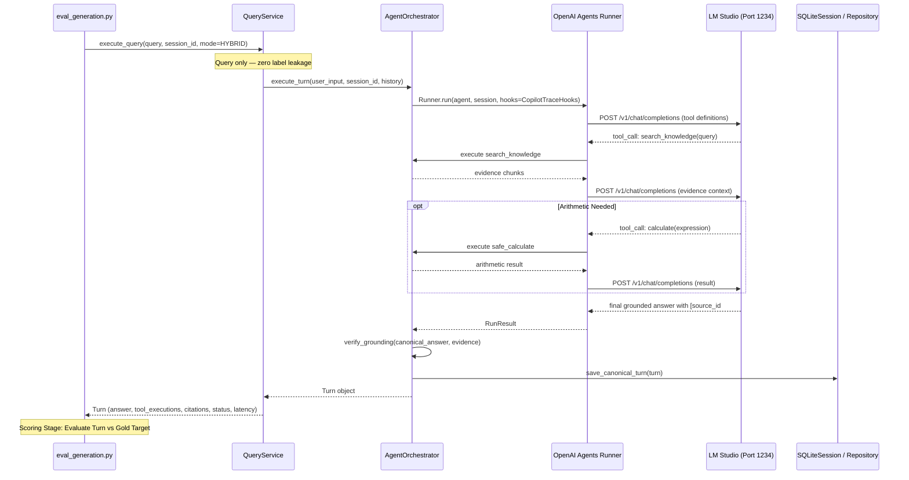

# Generation Evaluation and Grounding Faithfulness Specification
## Local Engineering Knowledge Copilot (Lab 7)

**Document Version:** 2.0.0  
**Evaluated Artifact:** `labs/lab07_final_project/evaluation/baselines/generation_results.json`  
**Evaluation Harness:** `labs/lab07_final_project/evaluation/eval_generation.py`  
**Target Scope:** `final_acceptance_holdout_50.json` (50 queries) and `frozen_eval_100.json` (100 queries)  

---

## 1. Live Runtime Status and Scorecard

In accordance with the non-negotiable scientific evaluation contract:
1. Generation evaluation must execute genuine inference through `QueryService.execute_query -> AgentOrchestrator -> Runner.run -> LM Studio`.
2. Answer-producing code is strictly isolated from evaluation labels (`expected_answer`, `refusal_expected`, `relevant_doc_ids`).
3. When the local LLM host dependency (LM Studio on port 1234) is offline or unreachable, **all generation metrics are marked `NOT_VERIFIED`** and the live acceptance gate is marked **`BLOCKED (Host Dependency Offline)`**. No synthetic templates or fabricated answers may be substituted.

| Metric | Scientific Target | Host Offline Status | Host Online Specification |
| :--- | :--- | :---: | :--- |
| **Unsupported Query Refusal** | 100% | **NOT_VERIFIED** | Verified via `is_refusal_answer` and `GroundingStatus.INSUFFICIENT_EVIDENCE` |
| **Fabricated Citations** | 0 | **NOT_VERIFIED** | Parsed `[source_id#chunk_id]` tags checked against retrieved chunk IDs |
| **Citation Validity Rate** | 100% | **NOT_VERIFIED** | Every cited passage must exist in the retrieved evidence accumulator |
| **Calculator Execution** | 100% on numeric questions | **NOT_VERIFIED** | Verified via actual `calculate` tool execution record in `turn.tool_executions` |
| **Cross-Doc Coverage** | $\ge 80\%$ | **NOT_VERIFIED** | Verified by presence of citations across all referenced target documents |
| **End-to-End Latency P50** | $\le 200\text{ ms}$ | **NOT_VERIFIED** | Wall-clock latency of real agent inference turn |
| **End-to-End Latency P95** | $\le 400\text{ ms}$ | **NOT_VERIFIED** | 95th percentile wall-clock latency of real agent inference turn |
| **Live Host Gate** | Active Inference on Port 1234 | **BLOCKED** | Host runtime dependency offline at `http://localhost:1234/v1` |

---

## 2. Real Agent Call Path and Tracing Architecture

The actual generation path executed by `evaluation/eval_generation.py` follows:

---

## 3. Grounding Verification & Tool Execution Semantics

### 3.1 Tool Call Tracing
Tool invocations are never inferred from string matching on assistant prose. Every reported tool execution must originate from `CopilotTraceHooks.on_tool_end` and be recorded in `turn.tool_executions` with:
- `tool_name`: Exact registered tool function (`search_knowledge`, `list_knowledge_sources`, `calculate`).
- `arguments`: Parsed argument dictionary.
- `result`: Structured return payload.
- `execution_time_ms`: Monotonic wall-clock runtime of the tool.

### 3.2 Refusal Detection
When a query targets facts outside the corpus:
- The system must return `grounding_status = GroundingStatus.INSUFFICIENT_EVIDENCE`.
- The canonical answer must state lack of evidence without confabulating details.

---

## 4. Human-in-the-Loop Protocol Specification

To prevent unsubstantiated claims of human-model agreement, manual evaluation is governed by the following strict schema. Any reported manual review must provide verifiable records:

### Review Schema:
1. `evaluation_run_id`: UUID of the live benchmark run.
2. `query_id`: Query identifier from the dataset.
3. `generated_answer`: Verbatim text produced by the model.
4. `cited_passages`: List of passage IDs cited in the answer.
5. `human_reviewer_id`: Identity of the technical auditor.
6. `timestamp_utc`: ISO 8601 timestamp.
7. `criteria_judged`:
   - *Factual correctness*: True / False.
   - *Claim entailment*: Fully Entailed / Partially Entailed / Contradicted / Unsupported.
   - *Citation accuracy*: Exact match to supporting sentence in source.
8. `audit_log_path`: Path to committed JSON review record.

*Note:* In offline execution environments where LM Studio is offline, no live answers exist to audit; therefore, human evaluation claims remain unasserted until live runs are conducted.
