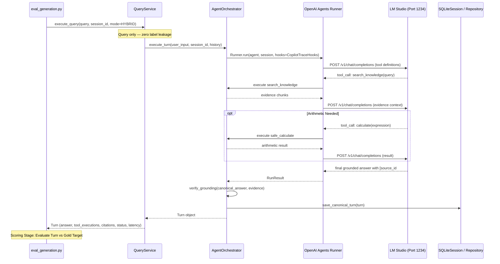

# Generation Evaluation and Grounding Faithfulness Specification
## Local Engineering Knowledge Copilot (Lab 7)

**Document Version:** 3.0.0  
**Evaluated Artifacts:** `labs/lab07_final_project/evaluation/baselines/generation_results.json` (`generation_results_v4.json`), `refusal_evaluation_results.json`, `live_acceptance_evidence.json`  
**Evaluation Harnesses:** `labs/lab07_final_project/evaluation/eval_generation.py`, `eval_refusal.py`, `run_live_acceptance.py`  
**Target Scope:** `final_acceptance_holdout_v4_independent_50.json` (50 unseen queries), `final_acceptance_holdout_v3_independent_50.json` (50 diagnostic queries; archived in `generation_results_v3.json`), and `frozen_eval_100.json` (100 retrieval queries)  

---

## 1. Live Runtime Status and Scorecard

In accordance with the non-negotiable scientific evaluation contract:
1. Generation evaluation must execute genuine inference through `QueryService.execute_query -> AgentOrchestrator -> Runner.run -> LM Studio`.
2. Answer-producing code is strictly isolated from evaluation labels (`expected_answer`, `refusal_expected`, `relevant_doc_ids`).
3. Whenever LM Studio (`http://localhost:1234/v1`) is offline during a run, no synthetic answers may be substituted (`NOT_VERIFIED` / `BLOCKED (Host Dependency Offline)`). The committed baseline below was executed live (**`VERIFIED_LIVE`**) against `mistralai/ministral-3-3b` in LM Studio and Redis Stack (`redis://localhost:6380`, 142 indexed chunks).

### 1.1 Frozen Unseen Independent Holdout (`v4_independent`, 50 Queries)

Authoritative results from `generation_results.json` / `generation_results_v4.json` (`48/50` successful turns, `execution_failures = 2` on `final_v4_indep_031` and `final_v4_indep_037`):

| Metric | Gate Target | Diagnostic `v3` (`v3_independent`) | Frozen Unseen `v4` (`v4_independent`) | Gate Status (`v4`) |
| :--- | :--- | :---: | :---: | :--- |
| **Execution Failures** | $= 0$ | 0 / 50 (0.0000) | **2 / 50 (4.0%)** | **FAIL** |
| **Fabricated Citations** | $= 0$ | 0 / 40 | **2** (`final_v4_indep_038`, 1 hash typo) | **FAIL** |
| **Factual Answer Correctness** | $\ge 0.8000$ | 31 / 40 (0.7750) | **30 / 40 (0.7500)** | **FAIL** |
| **Claim Support Rate** | $\ge 0.8500$ | 18 / 40 (0.4500) | **29 / 40 (0.7250)** (+27.5 pp) | **FAIL** |
| **Citation Validity Rate** | $\ge 0.8500$ | 30.0 / 40 (0.7500) | **32.5 / 40 (0.8125)** (+6.25 pp) | **FAIL** |
| **Unsupported Query Refusal** | $\ge 0.9000$ | 5 / 10 (0.5000) | **10 / 10 (1.0000)** (+50.0 pp) | **PASS** |
| **AST Calculator Usage** | $\ge 0.8000$ | 8 / 10 (0.8000) | **6 / 10 (0.6000)** (1 auto, 5 recovery) | **FAIL** |
| **Tool Execution / Arg Validity** | $\ge 0.9500$ | 1.0000 / 1.0000 | **1.0000 / 1.0000** | **PASS** |
| **Cross-Document Coverage** | $\ge 0.8000$ | 8.0 / 10 (0.8000) | **8.0 / 10 (0.8000)** | **PASS** |
| **Multi-Turn Interaction** | $= 1.0000$ | 0 / 1 (0.0000) | **1 / 1 (1.0000)** | **PASS** |
| **End-to-End Latency** | Measured (local 3B GPU/CPU) | P50 `30.13s` / P95 `89.26s` | P50 **`62.83s`** / P95 **`184.06s`** / Mean **`77.49s`** | Local LLM inference telemetry |
| **Overall Generation Gate** | All strict targets met | FAIL | **`FAIL` (Sub-Target Baseline)** | Honest Empirical Report |

### 1.2 Complementary Live Gates (`live_acceptance_evidence.json` & `refusal_evaluation_results.json`)

- **6 Live Acceptance Scenarios (`run_live_acceptance.py`)**: **`VERIFIED_LIVE` / `PASS` (`6/6` passed)** — Scenarios 1, 2, 3, and 5 all achieved `GROUNDED` with `1.0` citation validity; Scenario 4 achieved `INSUFFICIENT_EVIDENCE` (`is_refusal: true`, 0 fabricated citations); Scenario 6 verified document ingest + purge (`918.79 ms`).
- **Epistemic Refusal & Calibration Evaluation (`eval_refusal.py`)**: **`VERIFIED_LIVE` — 5/5 live refusal metrics `PASS`**:
  - `true_refusal_rate`: **11 / 11 (1.0000)** (target $\ge 0.90$)
  - `false_refusal_rate`: **4 / 43 (0.0930)** (target $\le 0.10$)
  - `unsupported_confident_answer_rate`: **0 / 11 (0.0000)** (target $\le 0.10$)
  - `grounded_partial_answer_rate`: **13 / 14 (0.9286)** (target $\ge 0.80$)
  - `adversarial_refusal_rate`: **11 / 11 (1.0000)** (target $\ge 0.90$)

---

## 2. Real Agent Call Path and Tracing Architecture

The actual generation path executed by `evaluation/eval_generation.py` follows:

---

## 3. Grounding Verification & Tool Execution Semantics

### 3.1 Tool Call Tracing
Tool invocations are never inferred from string matching on assistant prose. Every reported tool execution must originate from `CopilotTraceHooks.on_tool_end` and be recorded in `turn.tool_executions` with:
- `tool_name`: Exact registered tool function (`search_knowledge`, `list_knowledge_sources`, `calculate`).
- `arguments`: Parsed argument dictionary.
- `result`: Structured return payload.
- `execution_time_ms`: Monotonic wall-clock runtime of the tool.

### 3.2 Refusal Detection
When a query targets facts outside the corpus:
- The system must return `grounding_status = GroundingStatus.INSUFFICIENT_EVIDENCE`.
- The canonical answer must state lack of evidence without confabulating details.

---

## 4. Human-in-the-Loop Protocol Specification

To prevent unsubstantiated claims of human-model agreement, manual evaluation is governed by the following strict schema. Any reported manual review must provide verifiable records:

### Review Schema:
1. `evaluation_run_id`: UUID of the live benchmark run.
2. `query_id`: Query identifier from the dataset.
3. `generated_answer`: Verbatim text produced by the model.
4. `cited_passages`: List of passage IDs cited in the answer.
5. `human_reviewer_id`: Identity of the technical auditor.
6. `timestamp_utc`: ISO 8601 timestamp.
7. `criteria_judged`:
   - *Factual correctness*: True / False.
   - *Claim entailment*: Fully Entailed / Partially Entailed / Contradicted / Unsupported.
   - *Citation accuracy*: Exact match to supporting sentence in source.
8. `audit_log_path`: Path to committed JSON review record.

*Note:* In offline execution environments where LM Studio is offline, no live answers exist to audit; therefore, human evaluation claims remain unasserted until live runs are conducted.
